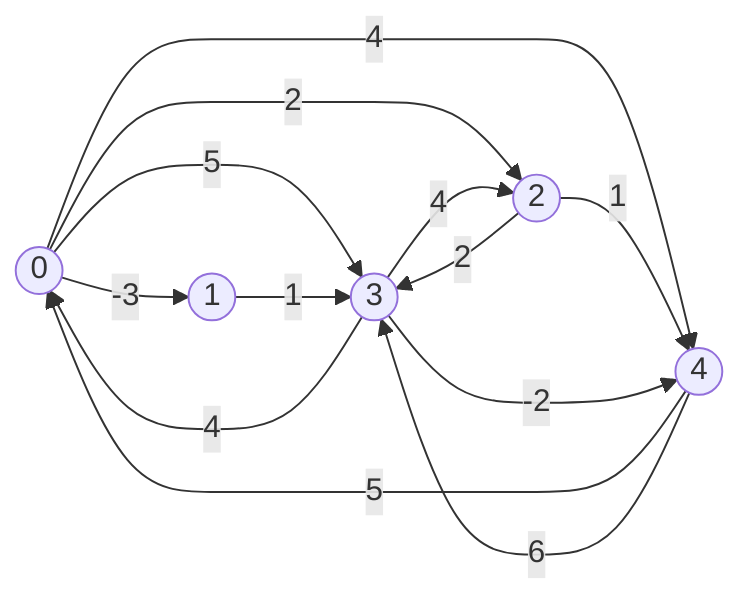
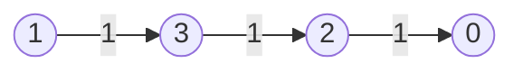
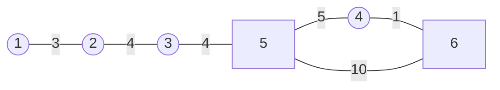
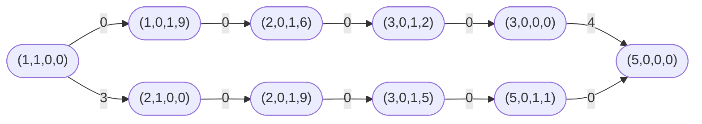

# Floyd-Warshall y los grafos de estado · AyG

**Material de apoyo del segundo corte.**

Hasta aquí los caminos más cortos salían de una fuente y la respuesta cabía en
un arreglo. Ahora se piden todas las parejas, y la respuesta pasa a ser una
matriz de $n \times n$. Repetir un algoritmo de una fuente desde cada vértice
resuelve el problema y a veces es lo que conviene, pero en un grafo denso con
pesos negativos cuesta $\Theta(n^4)$. Floyd-Warshall llega al mismo resultado
en $\Theta(n^3)$ y en tres ciclos anidados, porque parte los caminos por otro
lado: no por cuántas aristas tienen, sino por cuáles vértices se dejan usar
como intermedios. Aquí se sigue sobre un grafo de cinco vértices, doce
aristas y dos pesos negativos, matriz por matriz, y cierra volviendo a
UVa 10269, *Adventure of Super Mario*, con las seis preguntas que se responden
de un problema de grafos de estado.

Al terminar esta lectura se espera poder:

- Escribir la matriz de pesos de un grafo y decir qué significa cada entrada
  de $D^{(k)}$.
- Calcular a mano las matrices $D^{(0)}$ a $D^{(n)}$ de un grafo pequeño y
  leer en la diagonal si hay un ciclo negativo.
- Escribir Floyd-Warshall con una sola matriz, y explicar por qué se puede
  escribir encima y por qué el ciclo de $k$ va por fuera.
- Reconstruir un camino con la matriz `nex`.
- Escoger entre repetir Dijkstra, repetir Bellman-Ford-Moore y Floyd-Warshall
  según la densidad del grafo y el signo de los pesos.
- Responder las seis preguntas de un problema de grafos de estado y decidir
  qué elementos del estado sobran.

## Diapositivas

[apoyo-floyd-warshall.pdf](./apoyo-floyd-warshall.pdf){ target=_blank rel=noopener },
92 páginas. Las seis matrices del ejemplo llevan en rojo las entradas que
cambian en cada paso, y el grafo de estados de Super Mario aparece dibujado
con sus dos rutas.

## Lo que ya está

Cuatro algoritmos de una fuente, cada uno con su condición:

| Algoritmo | Cuándo sirve | Costo |
|---|---|---|
| Amplitud | todas las aristas pesan lo mismo | $O(n + m)$ |
| Una pasada en orden topológico | el grafo no tiene ciclos; admite pesos negativos | $O(n + m)$ |
| Bellman-Ford-Moore | pesos de cualquier signo, y denuncia los ciclos negativos | $\Theta(nm)$ |
| Dijkstra | pesos no negativos | $O((n + m) \log n)$ |

Los cuatro devuelven un arreglo `dist` con las distancias desde la fuente.
La pregunta de esta sesión ya no es por una fuente sino por todas: la
distancia $\delta(i,j)$ para cada pareja de vértices.

### Repetir lo que ya se tiene

La primera idea no necesita un algoritmo nuevo. Si hay uno que resuelve una
fuente, se corre $n$ veces, una por cada vértice:

- Dijkstra $n$ veces: $O(n \cdot (n + m) \log n)$, con pesos no negativos.
- Bellman-Ford-Moore $n$ veces: $\Theta(n^2 m)$, con pesos de cualquier signo.

En un grafo denso, donde $m \approx n^2$, la segunda cuenta da $\Theta(n^4)$.
Floyd-Warshall resuelve lo mismo en $\Theta(n^3)$, admite pesos negativos y se
escribe en cinco líneas.

No siempre gana. En un grafo disperso con pesos no negativos, repetir
Dijkstra cuesta $O(n^2 \log n)$ contra el $\Theta(n^3)$ de Floyd-Warshall, y
con $n = 1000$ esa diferencia son dos órdenes de magnitud. La decisión depende
de la densidad y del signo de los pesos.

## La entrada y la salida

### La matriz de pesos

Con $V = \{0, 1, \ldots, n-1\}$, la entrada es la matriz $w$ de $n \times n$:

$$
w_{ij} = \begin{cases}
  0      & \text{si } i = j, \\
  w(i,j) & \text{si } i \neq j \text{ y } (i,j) \in E, \\
  \infty & \text{si } i \neq j \text{ y } (i,j) \notin E.
\end{cases}
$$

La salida es la matriz $D$ de $n \times n$ con $d_{ij} = \delta(i,j)$ para
toda pareja.

### Por qué una matriz y no listas de adyacencia

El algoritmo recorre parejas de vértices, no aristas. En cada paso pregunta
cuánto pesa ir de $i$ a $j$, incluso cuando no hay arista entre los dos. La
lista de adyacencia no responde eso en $O(1)$: habría que recorrer `G[i]`
buscando a $j$. La matriz sí, y es la estructura que el algoritmo consulta en
su ciclo más interno.

### Lo que se admite y lo que no

El grafo puede ser dirigido y los pesos pueden ser negativos. Un grafo no
dirigido es el caso particular en que cada arista $\{u,v\}$ pone
$w_{uv} = w_{vu}$.

Lo que no se admite son los ciclos de peso negativo. Con uno de ellos,
$\delta(i,j)$ deja de existir para las parejas que lo alcanzan, porque dar
otra vuelta siempre mejora. El algoritmo corre igual y la diagonal lo
denuncia: si al terminar algún $d_{ii} < 0$, hay un ciclo negativo que pasa
por $i$.

Una arista no dirigida con peso negativo ya es un ciclo negativo de dos
vértices, porque $u \to v \to u$ pesa $2w < 0$. Los pesos negativos solo
tienen sentido en grafos dirigidos.

## Los vértices intermedios

### Por dónde se parte el problema

Bellman-Ford-Moore parte los caminos por la cantidad de aristas: en la primera
ronda quedan resueltos los de a lo sumo una, en la segunda los de a lo sumo
dos. Con todas las parejas esa cuenta habría que repetirla $n$ veces. ¿Por
dónde más se puede partir un camino?

**Definición (vértice intermedio).** En un camino
$p = \langle v_1, v_2, \ldots, v_\ell \rangle$, los vértices intermedios son
los de $\{v_2, \ldots, v_{\ell-1}\}$: todos menos los dos extremos.

La respuesta de Floyd-Warshall es partir por el conjunto de vértices que se
dejan usar como intermedios, y hacerlo crecer de a uno:

$$
\emptyset \subset \{0\} \subset \{0,1\} \subset \cdots \subset
\{0, 1, \ldots, n-1\}.
$$

### La cantidad que se calcula

**Definición ($d^{(k)}_{ij}$).** Peso de un camino más corto de $i$ a $j$
cuyos vértices intermedios están todos en $\{0, 1, \ldots, k-1\}$, es decir,
entre los primeros $k$ vértices. Los extremos $i$ y $j$ no cuentan como
intermedios y pueden ser cualquier par de vértices.

Los dos extremos de la cuenta se leen directo de la definición. Con $k = 0$
no hay ningún intermedio permitido, así que el único camino posible es la
arista directa y $d^{(0)}_{ij} = w_{ij}$. Con $k = n$ están todos permitidos
y $d^{(n)}_{ij} = \delta(i,j)$, que es lo que se busca. Falta la fórmula que
pasa de $d^{(k)}$ a $d^{(k+1)}$ agregando un solo vértice al conjunto.

### Agregar el vértice $k$

Sea $p$ un camino más corto de $i$ a $j$ con intermedios en
$\{0, \ldots, k\}$. Hay dos casos y no hay un tercero:

- Si $k$ no aparece en $p$, sus intermedios ya estaban en
  $\{0, \ldots, k-1\}$ y $p$ vale lo que valía antes, $d^{(k)}_{ij}$.
- Si $k$ aparece en $p$, el camino se parte en $i \leadsto k$ y
  $k \leadsto j$, y ninguno de los dos pedazos usa a $k$ como intermedio, así
  que los dos están contados en $d^{(k)}$.

**Teorema (recurrencia; CLRS, Sección 25.2, p. 694).**

$$
d^{(k+1)}_{ij} = \min\left( d^{(k)}_{ij},\; d^{(k)}_{ik} + d^{(k)}_{kj}
\right).
$$

### Por qué $k$ aparece a lo sumo una vez

El segundo caso da por hecho que $k$ sale una sola vez en $p$. Sin ciclos
negativos eso se puede exigir: si un vértice se repitiera, el pedazo entre sus
dos apariciones es un ciclo de peso $\geq 0$ y quitarlo no empeora el camino,
así que siempre hay un camino más corto que es simple. Entonces la partición
$i \leadsto k \leadsto j$ es única.

Cada pedazo, además, es el más corto de su clase. Si hubiera un camino de $i$
a $k$ más barato con intermedios en $\{0, \ldots, k-1\}$, reemplazarlo daría
un camino de $i$ a $j$ más barato que $p$, y $p$ era el más corto. Es el mismo
argumento de subestructura que sostiene a Bellman-Ford-Moore.

Con un ciclo negativo la partición deja de valer, porque el camino más corto
ya no existe. El algoritmo sigue corriendo y sumando, y termina con la
diagonal negativa.

## El ejemplo paso a paso

### El grafo

Cinco vértices, del $0$ al $4$, y doce aristas dirigidas, dos de ellas con
peso negativo. No hay ciclos negativos.



En las matrices que siguen, la fila $i$ se lee desde $i$ y la columna $j$,
hasta $j$. Las entradas en negrita son las que cambiaron en ese paso.

### $D^{(0)}$: la matriz de pesos

| $D^{(0)}$ | $0$ | $1$ | $2$ | $3$ | $4$ |
|---|---|---|---|---|---|
| $0$ | $0$ | $-3$ | $2$ | $5$ | $4$ |
| $1$ | $\infty$ | $0$ | $\infty$ | $1$ | $\infty$ |
| $2$ | $\infty$ | $\infty$ | $0$ | $2$ | $1$ |
| $3$ | $4$ | $\infty$ | $4$ | $0$ | $-2$ |
| $4$ | $5$ | $\infty$ | $\infty$ | $6$ | $0$ |

La diagonal arranca en $0$, las parejas con arista traen su peso y las demás,
$\infty$. Ningún intermedio está permitido todavía.

La entrada $d_{01}$ es $-3$ y la entrada $d_{10}$ es $\infty$. ¿Por qué no son
iguales? Porque el grafo es dirigido: hay arista de $0$ a $1$ y no hay ninguna
de $1$ a $0$. La matriz de pesos de un grafo dirigido no es simétrica, y la de
distancias tampoco va a serlo.

### $D^{(1)}$: se permite pasar por $0$

| $D^{(1)}$ | $0$ | $1$ | $2$ | $3$ | $4$ |
|---|---|---|---|---|---|
| $0$ | $0$ | $-3$ | $2$ | $5$ | $4$ |
| $1$ | $\infty$ | $0$ | $\infty$ | $1$ | $\infty$ |
| $2$ | $\infty$ | $\infty$ | $0$ | $2$ | $1$ |
| $3$ | $4$ | $\mathbf{1}$ | $4$ | $0$ | $-2$ |
| $4$ | $5$ | $\mathbf{2}$ | $\mathbf{7}$ | $6$ | $0$ |

Solo mejoran las parejas $(i,j)$ que tienen cómo llegar a $0$ y cómo salir de
él, y eso deja las filas $3$ y $4$. La entrada $d_{31} = 4 + (-3) = 1$ es el
camino $3 \to 0 \to 1$; $d_{41} = 5 + (-3) = 2$ y $d_{42} = 5 + 2 = 7$ salen
igual, por la arista $4 \to 0$.

¿Por qué la fila $1$ no cambia, si $0$ ya está permitido? Porque desde $1$ no
hay arista hacia $0$, así que $d^{(1)}_{10} = \infty$ y ningún camino que
empiece en $1$ puede pasar por $0$ como primer salto.

### $D^{(2)}$: se permite pasar por $0$ y por $1$

| $D^{(2)}$ | $0$ | $1$ | $2$ | $3$ | $4$ |
|---|---|---|---|---|---|
| $0$ | $0$ | $-3$ | $2$ | $\mathbf{-2}$ | $4$ |
| $1$ | $\infty$ | $0$ | $\infty$ | $1$ | $\infty$ |
| $2$ | $\infty$ | $\infty$ | $0$ | $2$ | $1$ |
| $3$ | $4$ | $1$ | $4$ | $0$ | $-2$ |
| $4$ | $5$ | $2$ | $7$ | $\mathbf{3}$ | $0$ |

Ahora $1$ sirve de puente. La entrada $d_{03} = -3 + 1 = -2$ es el camino
$0 \to 1 \to 3$, que mejora el $5$ de la arista directa. Y $d_{43} = 2 + 1 = 3$
usa el $d_{41} = 2$ que la matriz anterior acababa de dejar: el camino es
$4 \to 0 \to 1 \to 3$, de tres aristas, armado con dos mejoras encadenadas.

### $D^{(3)}$: se agrega el $2$

| $D^{(3)}$ | $0$ | $1$ | $2$ | $3$ | $4$ |
|---|---|---|---|---|---|
| $0$ | $0$ | $-3$ | $2$ | $-2$ | $\mathbf{3}$ |
| $1$ | $\infty$ | $0$ | $\infty$ | $1$ | $\infty$ |
| $2$ | $\infty$ | $\infty$ | $0$ | $2$ | $1$ |
| $3$ | $4$ | $1$ | $4$ | $0$ | $-2$ |
| $4$ | $5$ | $2$ | $7$ | $3$ | $0$ |

Una sola mejora: $d_{04} = 2 + 1 = 3$, por $0 \to 2 \to 4$, contra el $4$ de
la arista directa. Tres vértices permitidos y la matriz casi no se mueve. El
trabajo grande llega con el $3$, que es el vértice con aristas de salida hacia
casi todos.

### $D^{(4)}$: se agrega el $3$

| $D^{(4)}$ | $0$ | $1$ | $2$ | $3$ | $4$ |
|---|---|---|---|---|---|
| $0$ | $0$ | $-3$ | $2$ | $-2$ | $\mathbf{-4}$ |
| $1$ | $\mathbf{5}$ | $0$ | $\mathbf{5}$ | $1$ | $\mathbf{-1}$ |
| $2$ | $\mathbf{6}$ | $\mathbf{3}$ | $0$ | $2$ | $\mathbf{0}$ |
| $3$ | $4$ | $1$ | $4$ | $0$ | $-2$ |
| $4$ | $5$ | $2$ | $7$ | $3$ | $0$ |

Siete entradas cambian de golpe. La fila $1$ pasa de tener tres $\infty$ a
estar completa, porque $1 \to 3$ cuesta $1$ y desde $3$ se llega a todo:
$d_{10} = 1 + 4 = 5$ y $d_{14} = 1 + (-2) = -1$. La entrada
$d_{04} = -2 + (-2) = -4$ corresponde a $0 \to 1 \to 3 \to 4$ y usa el $-2$
que la fila $0$ traía desde $D^{(2)}$.

En esta matriz $d_{24}$ pasó de $1$ a $0$, y la arista $2 \to 4$ pesa $1$.
¿Por dónde se llega con peso $0$? Por $2 \to 3 \to 4$, que cuesta
$2 + (-2) = 0$. El peso negativo de la última arista paga el rodeo.

### $D^{(5)}$: el resultado

| $D^{(5)}$ | $0$ | $1$ | $2$ | $3$ | $4$ |
|---|---|---|---|---|---|
| $0$ | $0$ | $-3$ | $2$ | $-2$ | $-4$ |
| $1$ | $\mathbf{4}$ | $0$ | $5$ | $1$ | $-1$ |
| $2$ | $\mathbf{5}$ | $\mathbf{2}$ | $0$ | $2$ | $0$ |
| $3$ | $\mathbf{3}$ | $\mathbf{0}$ | $4$ | $0$ | $-2$ |
| $4$ | $5$ | $2$ | $7$ | $3$ | $0$ |

Con el $4$ permitido mejoran las entradas que llegan a $0$ y a $1$ dando la
vuelta por $4$: $d_{10} = -1 + 5 = 4$, por $1 \to 3 \to 4 \to 0$, y
$d_{31} = -2 + 2 = 0$, por $3 \to 4 \to 0 \to 1$. La diagonal quedó en $0$,
así que el grafo no tiene ciclos negativos.

### Lo que muestra el ejemplo

Las mejoras se encadenan y ninguna entrada se calcula de corrido.
$d_{10} = 4$ corresponde al camino $1 \to 3 \to 4 \to 0$, de tres aristas, y
salió de $d_{14} = -1$, que a su vez salió de la arista $1 \to 3$ y del paso
por $3$. En ningún momento el algoritmo recorrió ese camino entero.

El orden de los vértices tampoco cambia el resultado. Permitir primero el $3$
y después el $0$ da la misma matriz final; lo que cambia es en qué paso
aparece cada mejora, igual que el orden de relajación en Bellman-Ford-Moore.

## La implementación

### El código completo

[250407-agra-floydwarshall.py](./codigo/250407-agra-floydwarshall.py) trae las
dos versiones: `floydWarshallNoOpt`, que guarda las $n+1$ matrices, y
`floydWarshall`, que trabaja sobre una sola. Los números de línea son los que
cita el resto de la nota.

```python linenums="1"
"""
Implementación Algoritmo de Floyd-Warshall

"""

def floydWarshallNoOpt(w):
    n = len(w)
    d = [[[float("inf") for j in range(n)] for i in range(n)] for _ in range(n + 1)]
    nex = [[[-1 for j in range(n)] for i in range(n)] for _ in range(n + 1)]

    for i in range(n):
        for j in range(n):
            d[0][i][j] = w[i][j]
            nex[0][i][j] = j
    for i in range(n):
        d[0][i][i], nex[0][i][i] = 0, i

    print("####################### Pasos intermedios ###########################")
    print("------> d0")
    print(d[0])
    print("***************************")
        
    for k in range(0, n):
        for i in range(0, n):
            for j in range(0, n):
                d[k + 1][i][j] = d[k][i][j]
                nex[k + 1][i][j] = nex[k][i][j]
                if d[k][i][k] + d[k][k][j] < d[k + 1][i][j]:
                    d[k + 1][i][j] = d[k][i][k] + d[k][k][j]
                    nex[k + 1][i][j] = nex[k][i][k]
        print("------> d", k + 1)
        print(d[k + 1])
        print("***************************")
    return d[n], nex[n]

def floydWarshall(w):
    n = len(w)
    d = [[float("inf") for j in range(n)] for i in range(n)]
    nex = [[-1 for j in range(n)] for i in range(n)]

    for i in range(n):
        for j in range(n):
            d[i][j] = w[i][j]
            nex[i][j] = j
    for i in range(n):
        d[i][i], nex[i][i] = 0, i

    print("####################### Pasos intermedios ###########################")
    print("------> d0")
    print(d)
    print("***************************")
        
    for k in range(0, n):
        for i in range(0, n):
            for j in range(0, n):
                if d[i][k] + d[k][j] < d[i][j]:
                    d[i][j] = d[i][k] + d[k][j]
                    nex[i][j] = nex[i][k]
        print("------> d", k + 1)
        print(d)
        print("***************************")
    return d, nex

def main():
    w = [[0, -3, 2, 5, 4],
         [float('inf'), 0, float('inf'), 1, float('inf')],
         [float('inf'), float('inf'), 0, 2, 1],
         [4, float('inf'), 4, 0, -2],
         [5, float('inf'), float('inf'), 6, 0]]
    d, nex = floydWarshallNoOpt(w)
    
    print("####################### Resultados ###########################")
    print(d)
    print("***************************")
    print(nex)
    
    d, nex = floydWarshall(w)
    
    print("####################### Resultados ###########################")
    print(d)
    print("***************************")
    print(nex)

main()
```

Cada una imprime las matrices intermedias. Esas impresiones sirven para
seguir el algoritmo y para revisar un paso a mano; en una solución que se
envía a un juez se quitan.

### El arranque

```python linenums="7"
    n = len(w)
    d = [[[float("inf") for j in range(n)] for i in range(n)] for _ in range(n + 1)]
    nex = [[[-1 for j in range(n)] for i in range(n)] for _ in range(n + 1)]

    for i in range(n):
        for j in range(n):
            d[0][i][j] = w[i][j]
            nex[0][i][j] = j
    for i in range(n):
        d[0][i][i], nex[0][i][i] = 0, i
```

En $D^{(0)}$ queda la matriz de pesos tal cual: la arista directa o $\infty$.
La diagonal se pone en $0$ aparte, en la línea 16, porque quedarse quieto no
cuesta nada.

Esa línea no es un detalle de limpieza. Si $d_{ii}$ arranca en $\infty$, la
recurrencia nunca lo corrige, porque el mínimo entre $\infty$ y una suma que
incluye $\infty$ sigue siendo $\infty$. Todas las parejas cuyo camino más
corto necesite volver a pasar por $i$ quedan mal, y la detección de ciclos
negativos deja de funcionar.

### Los tres ciclos

```python linenums="23"
    for k in range(0, n):
        for i in range(0, n):
            for j in range(0, n):
                d[k + 1][i][j] = d[k][i][j]
                nex[k + 1][i][j] = nex[k][i][j]
                if d[k][i][k] + d[k][k][j] < d[k + 1][i][j]:
                    d[k + 1][i][j] = d[k][i][k] + d[k][k][j]
                    nex[k + 1][i][j] = nex[k][i][k]
```

Las líneas 26 y 27 copian: lo que valía sin pasar por $k$ sigue valiendo. La
línea 28 pregunta si ir por $k$ sale más barato y compara contra la copia
recién hecha. Las líneas 29 y 30 se quedan con el camino por $k$, en la
distancia y en `nex`. Es la recurrencia traducida sin más: `d[k]` es $D^{(k)}$
y de ahí sale `d[k+1]`.

### El ciclo de $k$ va por fuera

Cuando se calcula $d^{(k+1)}_{ij}$, las dos entradas que se consultan,
$d^{(k)}_{ik}$ y $d^{(k)}_{kj}$, son de la matriz completa del paso anterior.
Si $k$ fuera el ciclo de más adentro, esa matriz no existiría todavía: el
algoritmo estaría mirando valores a medio calcular.

El contraejemplo más pequeño tiene cuatro vértices y tres aristas de peso $1$:
$1 \to 3$, $3 \to 2$ y $2 \to 0$. Es un camino en fila, y $\delta(1,0) = 3$.



Con el ciclo de $k$ por fuera, $d_{10} = 3$. Con el orden $i$, $j$, $k$, es
decir con $k$ adentro, $d_{10}$ se queda en $\infty$. Cuando le llega el turno
a la pareja $(1,0)$, el único $k$ que serviría es $3$, pero el camino de $3$ a
$0$ todavía no se conoce: esa pareja se mira después, en la vuelta de $i = 3$,
y para entonces la fila $1$ ya pasó y no se vuelve a visitar.

El error es frecuente y difícil de ver, porque en muchos grafos el resultado
sale bien de todas formas. Hace falta un grafo donde una mejora dependa de
otra que viene más adelante en el orden de las filas, y eso es justo lo que el
camino en fila construye.

### El espacio que cuesta guardar todo

Son $n+1$ matrices de $n \times n$, es decir $\Theta(n^3)$ en espacio. Con
$n = 500$ eso son $125$ millones de casillas, y el algoritmo solo necesita la
anterior para calcular la siguiente.

Si lo único que hace falta es $D^{(k)}$ para calcular $D^{(k+1)}$, ¿se puede
escribir encima de la misma matriz? Lo que preocupa es leer una casilla que ya
se modificó en esta misma vuelta.

### La fila $k$ y la columna $k$ no se mueven

Para calcular $d_{ij}$ en la vuelta $k$ se consultan $d_{ik}$ y $d_{kj}$: la
columna $k$ y la fila $k$. Esas son las únicas casillas que se leen, y resulta
que son exactamente las que no cambian.

**Teorema.** En la vuelta $k$, para todo $i$ y todo $j$,
$d^{(k+1)}_{ik} = d^{(k)}_{ik}$ y $d^{(k+1)}_{kj} = d^{(k)}_{kj}$.

**Demostración.** Se procede de forma directa.

**Desarrollo.** Por la recurrencia,
$d^{(k+1)}_{ik} = \min(d^{(k)}_{ik},\; d^{(k)}_{ik} + d^{(k)}_{kk})$. Sin
ciclos negativos $d^{(k)}_{kk} = 0$, así que el segundo término del mínimo es
igual al primero y el mínimo es $d^{(k)}_{ik}$. El mismo cálculo, con los
índices al otro lado, da $d^{(k+1)}_{kj} = d^{(k)}_{kj}$.

**Conclusión.** Por lo tanto, se puede concluir que leer la fila $k$ y la
columna $k$ de la matriz a medio actualizar da lo mismo que leerlas de
$D^{(k)}$, y la versión de una sola matriz calcula los mismos valores.

### Una sola matriz

```python linenums="36"
def floydWarshall(w):
    n = len(w)
    d = [[float("inf") for j in range(n)] for i in range(n)]
    nex = [[-1 for j in range(n)] for i in range(n)]

    for i in range(n):
        for j in range(n):
            d[i][j] = w[i][j]
            nex[i][j] = j
    for i in range(n):
        d[i][i], nex[i][i] = 0, i
```

```python linenums="53"
    for k in range(0, n):
        for i in range(0, n):
            for j in range(0, n):
                if d[i][k] + d[k][j] < d[i][j]:
                    d[i][j] = d[i][k] + d[k][j]
                    nex[i][j] = nex[i][k]
```

Desaparecieron el índice de la matriz y las dos líneas que copiaban: la
casilla que no mejora se queda como está. Son tres ciclos, un `if` y dos
asignaciones.

| | Con todas las matrices | Con una sola |
|---|---|---|
| Tiempo | $\Theta(n^3)$ | $\Theta(n^3)$ |
| Espacio | $\Theta(n^3)$ | $\Theta(n^2)$ |
| $n = 500$ | $125$ millones de casillas | $250$ mil casillas |
| Qué deja ver | cada $D^{(k)}$ por separado | solo el resultado |

La primera sirve para seguir el algoritmo y para revisar a mano un paso
intermedio. La que se envía al juez es la segunda.

## Reconstruir el camino

### La matriz `nex`

**Definición ($\mathit{nex}_{ij}$).** El vértice que sigue después de $i$ en
un camino más corto de $i$ a $j$.

Arranca en $j$, que es a donde lleva la arista directa, y se actualiza cuando
la pareja mejora. Si el camino de $i$ a $j$ pasa a ir por $k$, el primer paso
deja de ser el que era y pasa a ser el primero del camino de $i$ a $k$:

$$
\mathit{nex}_{ij} \leftarrow \mathit{nex}_{ik}.
$$

En el código es la línea 58, al lado de la que mejora la distancia.

Bellman-Ford-Moore y Dijkstra guardan el anterior, en `pred`, y el camino sale
invertido. Aquí se guarda el siguiente, y el camino se arma hacia adelante:
desde $i$ se salta a $\mathit{nex}_{ij}$ y se repite hasta llegar a $j$, sin
invertir nada.

### Armar el camino de $2$ a $1$

Esta es la matriz `nex` del ejemplo al terminar. En negrita, las entradas que
cambiaron durante la corrida; las demás quedaron en el valor con que
arrancaron.

| $\mathit{nex}$ | $0$ | $1$ | $2$ | $3$ | $4$ |
|---|---|---|---|---|---|
| $0$ | $0$ | $\mathbf{1}$ | $2$ | $1$ | $1$ |
| $1$ | $3$ | $1$ | $3$ | $3$ | $3$ |
| $2$ | $3$ | $\mathbf{3}$ | $2$ | $3$ | $3$ |
| $3$ | $4$ | $\mathbf{4}$ | $2$ | $3$ | $4$ |
| $4$ | $\mathbf{0}$ | $0$ | $0$ | $0$ | $4$ |

Según $D^{(5)}$, el camino de $2$ a $1$ pesa $2$. Para escribirlo se siguen
los saltos: $\mathit{nex}_{21} = 3$, de $2$ se pasa a $3$;
$\mathit{nex}_{31} = 4$, de $3$ se pasa a $4$; $\mathit{nex}_{41} = 0$, de $4$
se pasa a $0$; $\mathit{nex}_{01} = 1$, llegó. El camino es
$2 \to 3 \to 4 \to 0 \to 1$ y pesa $2 + (-2) + 5 + (-3) = 2$, que coincide con
la matriz de distancias.

Antes de seguir los saltos hay que mirar que $d_{ij} < \infty$. Para las
parejas sin camino, `nex` quedó en $j$ desde la inicialización, y armar el
camino sin esa revisión imprime una arista que no está en el grafo.

## Correctitud

### La matriz final es la de las distancias

**Teorema (CLRS, Sección 25.2).** Sea $G = (V, E, w)$ dirigido, con
$V = \{0, \ldots, n-1\}$ y sin ciclos negativos. Al terminar el algoritmo,
$d^{(n)}_{ij} = \delta(i,j)$ para toda pareja $(i,j)$.

**Demostración.** Se procede por inducción sobre $k$, con la afirmación de que
$d^{(k)}_{ij}$ es el peso de un camino más corto de $i$ a $j$ con intermedios
en $\{0, \ldots, k-1\}$.

**Desarrollo.** Con $k = 0$ no hay intermedios permitidos, el único camino de
$i$ a $j$ es la arista directa y $d^{(0)}_{ij} = w_{ij}$, que es lo que deja
la inicialización. Para el paso de $k$ a $k+1$, sea $p$ un camino más corto de
$i$ a $j$ con intermedios en $\{0, \ldots, k\}$. Si $k$ no está en $p$, por
hipótesis de inducción $w(p) = d^{(k)}_{ij}$. Si está, $p$ se parte en
$i \leadsto k$ y $k \leadsto j$, los dos con intermedios en
$\{0, \ldots, k-1\}$ y cada uno el más corto de su clase, de modo que
$w(p) = d^{(k)}_{ik} + d^{(k)}_{kj}$. La recurrencia toma el menor de los dos
valores, que es el que corresponda al caso en que se esté.

**Conclusión.** Por lo tanto, se puede concluir que $d^{(k)}_{ij}$ vale lo que
dice la afirmación para todo $k$, y en particular para $k = n$, donde todos
los vértices están permitidos y $d^{(n)}_{ij} = \delta(i,j)$.

### Los ciclos negativos salen en la diagonal

**Teorema.** $G$ tiene un ciclo de peso negativo si y solo si al terminar el
algoritmo existe $i$ con $d_{ii} < 0$.

Las dos direcciones son cortas. Un ciclo negativo que pasa por $i$ es un
recorrido de $i$ a $i$ de peso negativo, y al final todos sus vértices están
permitidos como intermedios, así que la recurrencia lo encuentra y deja
$d_{ii} < 0$. Al revés, si $d_{ii} < 0$ es porque se sumó un recorrido de $i$
a $i$ de peso negativo, y dentro de ese recorrido hay un ciclo negativo.

En el código, después de llamar la función basta recorrer `d[i][i]`. No hace
falta una ronda extra como en Bellman-Ford-Moore: la información ya quedó en
la matriz.

## Lo que cuesta y cuándo conviene

Tres ciclos anidados de $n$ vueltas y un cuerpo de tiempo constante dan
$\Theta(n^3)$, sin importar cuántas aristas haya. El espacio es $\Theta(n^2)$
con una sola matriz y $\Theta(n^3)$ si se guardan todas.

Que el costo no dependa de $m$ es la ventaja y la desventaja a la vez. Un
grafo de $2000$ vértices y $3000$ aristas cuesta lo mismo que uno de $2000$
vértices completo: ocho mil millones de operaciones en los dos casos.

| | Dijkstra $n$ veces | Bellman-Ford-Moore $n$ veces | Floyd-Warshall |
|---|---|---|---|
| Pesos negativos | no | sí | sí |
| Grafo denso | $O(n^3 \log n)$ | $\Theta(n^4)$ | $\Theta(n^3)$ |
| Grafo disperso | $O(n^2 \log n)$ | $\Theta(n^2 m)$ | $\Theta(n^3)$ |
| Espacio | $\Theta(n + m)$ | $\Theta(n + m)$ | $\Theta(n^2)$ |
| Qué hay que escribir | cola de prioridad | relajar aristas | tres ciclos |

La regla sale de la tabla. Grafo disperso y pesos no negativos: Dijkstra desde
cada vértice. Grafo denso, o pesos negativos, o $n$ chico: Floyd-Warshall.

Con un segundo de límite, $\Theta(n^3)$ alcanza hasta unos $400$ o $500$
vértices en Python y algo más en C++. Por encima de eso la pregunta ya no es
cuál algoritmo sino cuál problema se está resolviendo.

## Errores comunes

**El ciclo de $k$ adentro.** Es el más frecuente y el que más cuesta ver,
porque en muchos grafos el resultado sale bien igual. El contraejemplo de
cuatro vértices en fila lo destapa.

**La diagonal en $\infty$.** $d_{ii}$ arranca en $0$. Si arranca en $\infty$,
ninguna mejora la alcanza y además se pierde la detección de ciclos negativos.

**El infinito que se desborda.** En Python `float("inf")` suma sin problema.
En C++, con un entero grande como infinito, $\infty + \infty$ se devuelve
negativo y aparecen caminos que no existen. Se usa una cota grande que
resista la suma, o se pregunta antes de sumar.

**Seguir `nex` sin mirar la distancia.** Para las parejas sin camino, `nex`
quedó en $j$ desde la inicialización, y el recorrido imprime una arista que no
está en el grafo.

**Aristas repetidas en la entrada.** Si el problema admite dos vías entre los
mismos lugares, la matriz se llena con el mínimo de las dos, no con la última
que se lea.

## Volver sobre los grafos de estado

### Las seis preguntas

De un problema que se modela con un grafo de estados se responden seis cosas,
en este orden:

1. Por qué el grafo del enunciado no resuelve el problema directamente.
2. Qué elementos tiene el estado y en qué rango se mueve cada uno.
3. Las transiciones: qué condición pide cada una, qué elementos cambia y
   cuánto cuesta.
4. El estado inicial y cuáles son los finales.
5. Una parte del grafo de estados, dibujada para un ejemplo.
6. Con qué algoritmo se resuelve y cuánto cuesta, en términos de los datos de
   la entrada.

Las seis van completas. Un estado sin los rangos de sus elementos no deja
contar cuántos hay, y unas transiciones sin condición no dejan ver cuándo se
puede dar el paso.

### UVa 10269, Adventure of Super Mario

El enunciado está en <https://onlinejudge.org/external/102/10269.pdf> y el
envío se hace en
<https://onlinejudge.org/index.php?option=com_onlinejudge&Itemid=25&page=submit_problem&problemid=1210>.

Hay $A$ aldeas, numeradas de $1$ a $A$, y $B$ castillos, de $A+1$ a $A+B$,
unidos por vías de doble sentido. Caminar por una vía de longitud $\ell$ toma
$\ell$. Con la bota puesta se corre en tiempo $0$, a lo sumo $L$ por carrera y
a lo sumo $K$ carreras en total, y una carrera no atraviesa un castillo.

El ejemplo del enunciado tiene $A = 4$, $B = 2$, $L = 9$ y $K = 1$. Los
castillos son el $5$ y el $6$. Las vías son estas:



Los cuadrados son los castillos y los círculos, las aldeas.

Mario sale de la aldea $1$ y va al castillo $6$. La respuesta es $9$.

### Uno: por qué el grafo de lugares no basta

El grafo del enunciado sabe cuáles lugares hay y cuánto miden las vías. Con
eso, un algoritmo de caminos más cortos da el tiempo caminando y nada más.

Lo que no sabe es que el costo de una vía depende de con qué llega Mario. Con
la bota puesta y carga suficiente cuesta $0$; sin ella, cuesta su longitud.
Dos llegadas al mismo lugar con el mismo tiempo no valen lo mismo si a una le
quedan carreras y a la otra no.

### Dos: el estado y sus rangos

El estado es la tupla $(a, b, c, d)$:

- $a$, el lugar donde está Mario: $1 \leq a \leq A+B$.
- $b$, las carreras que le quedan: $0 \leq b \leq K$.
- $c$, si trae la bota puesta: $c \in \{0, 1\}$.
- $d$, lo que le queda a la carrera en curso: $0 \leq d \leq L$.

En total, $(A+B) \cdot (K+1) \cdot 2 \cdot (L+1)$ estados.

### Tres: las transiciones

| Transición | Condición | Qué cambia | Costo |
|---|---|---|---|
| Caminar a $a'$ por la vía de peso $v$ | $c = 0$ y existe la vía $(a, a')$ | $a$ | $v$ |
| Correr a $a'$ por la vía de peso $v$ | $c = 1$, $d \geq v$, y $a \leq A$ o $d = L$ | $a$, y $d$ queda en $d - v$ | $0$ |
| Ponerse la bota | $c = 0$ y $b > 0$ | $b$, $c$, y $d$ queda en $L$ | $0$ |
| Quitarse la bota | $c = 1$ | $c$, y $d$ queda en $0$ | $0$ |

La condición de correr dice tres cosas. Que $d \geq v$ es que la carga de la
carrera alcance para la vía. Que $a \leq A$ es que Mario esté en una aldea, y
que $d = L$ es que la carrera empiece justo ahí. Las dos últimas, en
disyunción, son la forma de decir que una carrera nunca atraviesa un castillo:
puede empezar en uno y puede terminar en uno, pero no seguir desde uno al que
llegó corriendo.

### Cuatro: el estado inicial y los finales

El inicial es $(1, K, 0, 0)$, con tiempo $0$. Los finales son todos los de la
forma $(A+B, b, c, d)$: una vez que llegó, lo demás da igual.

### Cinco: una parte del grafo de estados

Las dos rutas salen del mismo estado inicial y llegan al mismo estado
$(5,0,0,0)$. Lo único que cambia es dónde se pone Mario la bota.



Cada arista de arriba es una transición, y la tabla dice cuál:

| Desde | Hasta | Costo | Qué hace | Ruta |
|---|---|---|---|---|
| $(1,1,0,0)$ | $(1,0,1,9)$ | $0$ | se pone la bota en la aldea $1$ | arriba |
| $(1,0,1,9)$ | $(2,0,1,6)$ | $0$ | corre de $1$ a $2$, la vía mide $3$ | arriba |
| $(2,0,1,6)$ | $(3,0,1,2)$ | $0$ | corre de $2$ a $3$, la vía mide $4$ | arriba |
| $(3,0,1,2)$ | $(3,0,0,0)$ | $0$ | se quita la bota: quedan $2$ y faltan $4$ | arriba |
| $(3,0,0,0)$ | $(5,0,0,0)$ | $4$ | camina de $3$ al castillo $5$ | arriba |
| $(1,1,0,0)$ | $(2,1,0,0)$ | $3$ | camina de $1$ a $2$ | abajo |
| $(2,1,0,0)$ | $(2,0,1,9)$ | $0$ | se pone la bota en la aldea $2$ | abajo |
| $(2,0,1,9)$ | $(3,0,1,5)$ | $0$ | corre de $2$ a $3$ | abajo |
| $(3,0,1,5)$ | $(5,0,1,1)$ | $0$ | corre de $3$ al castillo $5$ | abajo |
| $(5,0,1,1)$ | $(5,0,0,0)$ | $0$ | se quita la bota | abajo |

Por arriba, la carrera que empieza en $1$ cubre $3 + 4 = 7$ y se queda corta
en la aldea $3$, con $d = 2$ y una vía de $4$ por delante: hay que caminarla,
y llegar al castillo $5$ cuesta $4$. Por abajo, caminar primero los $3$ hasta
$2$ deja la carrera entera para $4 + 4 = 8 \leq 9$, que para justo en el
castillo: llegar cuesta $3$.

Desde $(5,0,0,0)$ las dos rutas siguen igual, caminando $5$ hasta la aldea $4$
y $1$ hasta el castillo $6$. La de arriba termina en $4 + 6 = 10$ y la de
abajo en $3 + 6 = 9$, que es la respuesta.

### Seis: el algoritmo y lo que cuesta

Las transiciones cuestan $0$ o el peso de la vía, así que no todas valen lo
mismo y la búsqueda en amplitud no sirve. Ningún costo es negativo, así que
Dijkstra sobre el grafo de estados.

Con $n$ estados y $m$ transiciones, el costo es $O((n + m) \log n)$, donde

$$
n = (A+B)(K+1) \cdot 2 \cdot (L+1), \qquad
m \leq n \cdot (\deg_{\max} + 2).
$$

Con $A + B = 100$, $K = 10$ y $L = 500$ son $1\,102\,200$ estados.

El grafo de estados no se construye. Los sucesores se calculan cuando el
estado sale de la cola, y el diccionario guarda solo los estados a los que se
llegó. De todos los que cabrían, se visitan los alcanzables y nada más.

## Las dos implementaciones de Super Mario

### Con la bandera en el estado

[10269-super-mario-bandera.py](./codigo/10269-super-mario-bandera.py) lleva
los cuatro elementos del estado, uno por uno, y tiene una transición por cada
fila de la tabla.

```python linenums="1"
"""
Adventures of Super Mario
https://onlinejudge.org/external/102/10269.pdf

Dijkstra - SSSP

"""

from sys import stdin
from heapq import heappop, heappush

def solve(G, a, b, K, L):
  queue, vis, flag = [], dict(), False
  heappush(queue, (0, 1, 0, K, False))
  vis[(1, 0, K, False)] = 0
  while len(queue) > 0 and not flag:
    (c, u, l, k, boot) = heappop(queue)
      
    if u == a + b: flag = True
    else:
      if vis[(u, l, k, boot)] == c:
        # se coloca los zapatos especiales
        if k > 0 and not boot: 
          if (u, L, k - 1, True) not in vis or vis[(u, L, k - 1, True)] > c:              
            heappush(queue, (c, u, L, k - 1, True))
            vis[(u, L, k - 1, True)] = c
        # se quita los zapatos especiales
        if boot and ((u, 0, k, False) not in vis or vis[(u, 0, k, False)] > c):
          heappush(queue, (c, u, 0, k, False))
          vis[(u, 0, k, False)] = c
        # movimientos
        for (v, p) in G[u]:
          # se mueve sin usar los zapatos
          if not boot and ((v, 0, k, False) not in vis or vis[(v, 0, k, False)] > c + p):  
            heappush(queue, (c + p, v, 0, k, False))
            vis[(v, 0, k, False)] = c + p
          # se mueve usando los zapatos
          if boot and l >= p and (u <= a or l == L):
            if (v, l - p, k, boot) not in vis or vis[(v, l - p, k, boot)] > c:
              heappush(queue, (c, v, l - p, k, boot))
              vis[(v, l - p, k, boot)] = c
  return c

def main():
  cases = int(stdin.readline())
  while cases:
    a, b, m, L, K = map(int, stdin.readline().split())
    G = [[] for _ in range(a + b + 1)]
    for _ in range(m):
      u, v, p = map(int, stdin.readline().split())
      G[u].append((v, p))
      G[v].append((u, p))
    print(solve(G, a, b, K, L))
    cases -= 1

main()
```

La tupla del código es `(u, l, k, boot)`: `u` es $a$, `l` es $d$, `k` es $b$ y
`boot` es $c$.

### La cola y la pareja vieja

```python linenums="13"
  queue, vis, flag = [], dict(), False
  heappush(queue, (0, 1, 0, K, False))
  vis[(1, 0, K, False)] = 0
  while len(queue) > 0 and not flag:
    (c, u, l, k, boot) = heappop(queue)
      
    if u == a + b: flag = True
    else:
      if vis[(u, l, k, boot)] == c:
```

En la cola van tuplas `(c, u, l, k, boot)` con el tiempo adelante, que es por
donde ordena `heapq`. El diccionario `vis` hace el papel de `dist`: guarda el
menor tiempo conocido de cada estado. La línea 19 para el ciclo al sacar el
castillo $a+b$, como `dijkstraST`.

La línea 21 es el borrado perezoso de la segunda versión de Dijkstra. Si el
tiempo que trae la tupla no es el que `vis` tiene guardado, esa tupla quedó
vieja y se descarta sin expandirla.

### Ponerse y quitarse la bota

```python linenums="22"
        # se coloca los zapatos especiales
        if k > 0 and not boot: 
          if (u, L, k - 1, True) not in vis or vis[(u, L, k - 1, True)] > c:              
            heappush(queue, (c, u, L, k - 1, True))
            vis[(u, L, k - 1, True)] = c
        # se quita los zapatos especiales
        if boot and ((u, 0, k, False) not in vis or vis[(u, 0, k, False)] > c):
          heappush(queue, (c, u, 0, k, False))
          vis[(u, 0, k, False)] = c
```

Ninguna de las dos gasta tiempo: se empuja `c`, no `c` más algo. Lo que cambia es el
estado. Ponérsela, en la línea 23, pide que queden usos y que no la traiga
puesta; gasta un uso y deja la carga en `L`. Quitársela, en la línea 28, pide
traerla puesta y bota lo que quedaba de la carrera, que es lo que deja caminar
otra vez.

### Caminar y correr

```python linenums="31"
        # movimientos
        for (v, p) in G[u]:
          # se mueve sin usar los zapatos
          if not boot and ((v, 0, k, False) not in vis or vis[(v, 0, k, False)] > c + p):  
            heappush(queue, (c + p, v, 0, k, False))
            vis[(v, 0, k, False)] = c + p
          # se mueve usando los zapatos
          if boot and l >= p and (u <= a or l == L):
            if (v, l - p, k, boot) not in vis or vis[(v, l - p, k, boot)] > c:
              heappush(queue, (c, v, l - p, k, boot))
              vis[(v, l - p, k, boot)] = c
  return c
```

Caminar, en la línea 34, pide no traer la bota puesta y cuesta `p`, la
longitud de la vía. Correr, en la línea 38, pide traerla puesta, que la carga
alcance y que la carrera no siga desde un castillo; cuesta $0$ y descuenta `p`
de la carga.

En el estado $(5, 0, 1, 1)$ de la ruta de abajo, Mario está en el castillo $5$
con la bota puesta y $d = 1$. ¿Cuál de las cuatro transiciones puede dar?
Solo quitarse la bota. Correr no, porque $5$ es castillo y $d = 1 \neq L$, y
aunque fuera aldea la vía más corta desde $5$ mide $5 > 1$. Caminar tampoco,
porque la trae puesta. Ponérsela menos: ya la tiene y además $b = 0$.

### La bandera sobra

Quitarse la bota es gratis y siempre se puede. Entonces caminar desde un
estado con la bota puesta vale lo mismo que quitársela y caminar, y las dos
transiciones se pueden juntar en una sola que deja $d$ en $0$. Con eso,
$d = 0$ ya significa que no hay carrera en curso, y la bandera $c$ no agrega
nada que el estado no diga.

El estado pasa a ser $(a, b, d)$ y la cantidad de estados se parte por la
mitad: $(A+B)(K+1)(L+1)$, que con $A+B = 100$, $K = 10$ y $L = 500$ son
$551\,100$.

### Sin la bandera

[10269-super-mario.py](./codigo/10269-super-mario.py) es la versión que se
envía al juez.

```python linenums="1"
"""
Adventures of Super Mario
https://onlinejudge.org/external/102/10269.pdf

Dijkstra - SSSP

"""

from sys import stdin
from heapq import heappop, heappush

def main():
  cases = int(stdin.readline())
  while cases:
    a, b, m, L, K = map(int, stdin.readline().split())
    G = [[] for _ in range(a + b + 1)]
    for _ in range(m):
      u, v, p = map(int, stdin.readline().split())
      G[u].append((v, p))
      G[v].append((u, p))

    # estado (u, l, k): lugar, carga que le
    # queda a la bota (0 sin bota) y usos
    # vis[estado]: menor tiempo conocido
    queue, vis, flag = [], dict(), False
    heappush(queue, (0, 1, 0, K))
    vis[(1, 0, K)] = 0
    while len(queue) > 0 and not flag:
      (c, u, l, k) = heappop(queue)

      # al salir a + b, c es el mínimo
      if u == a + b: flag = True
      else:
        # tupla vieja: se descarta
        if vis[(u, l, k)] == c:
          # se coloca los zapatos especiales
          if l != L and k > 0:
            if (u, L, k - 1) not in vis or vis[(u, L, k - 1)] > c:
              heappush(queue, (c, u, L, k - 1))
              vis[(u, L, k - 1)] = c
          for (v, p) in G[u]:
            if (v, 0, k) not in vis or vis[(v, 0, k)] > c + p:
              # se mueve sin usar los zapatos
              heappush(queue, (c + p, v, 0, k))
              vis[(v, 0, k)] = c + p
            # se mueve usando los zapatos
            # alcanza la carga y u es aldea
            # o la carrera empieza en u
            if l >= p and (u <= a or l == L):
              if (v, l - p, k) not in vis or vis[(v, l - p, k)] > c:
                heappush(queue, (c, v, l - p, k))
                vis[(v, l - p, k)] = c
    print(c)
    cases -= 1

main()
```

Desapareció el bloque de quitarse la bota y desaparecieron las condiciones
`boot` y `not boot`. Ponérsela ahora pide `l != L`, que es la forma de decir
que no hay una carrera recién empezada, y caminar deja `l` en $0$ sin
preguntar nada.

### Lo que queda por mirar

Una carrera que sale de un lugar pasa solo por aldeas y cubre a lo sumo $L$.
Ese dato no depende de cuántos usos queden ni del tiempo acumulado, así que se
puede calcular una vez, antes de empezar, y guardar para cada lugar a cuáles
llega corriendo.

Si la carrera entera es una sola transición, $d$ sale del estado y quedan
$(a, b)$: $(A+B)(K+1)$ estados, unos mil cien en el peor caso contra el millón
de antes. Falta resolver cómo se calcula ese alcance. Es un recorrido desde
cada lugar que acumula distancia, se detiene en $L$ y no sigue desde un
castillo.

## Problemas de juez

### UVa 11463, Commandos

El enunciado está en <https://onlinejudge.org/external/114/11463.pdf> y el
envío se hace en
<https://onlinejudge.org/index.php?option=com_onlinejudge&Itemid=25&page=submit_problem&problemid=2458>.

Un grafo sin pesos y dos lugares fijos, el de salida y el del encuentro. Para
cada edificio se suma la distancia desde la salida y la distancia hasta el
encuentro, y se toma el mayor de esos valores.

**Cómo atacarlo.** Con $n \leq 100$, la matriz completa sale gratis. Las vías
no tienen peso y la matriz arranca con unos donde hay arista. La trampa es el
caso de un solo edificio, donde la respuesta es $0$.

### UVa 821, Page Hopping

El enunciado está en <https://onlinejudge.org/external/8/821.pdf> y el envío
se hace en
<https://onlinejudge.org/index.php?option=com_onlinejudge&Itemid=25&page=submit_problem&problemid=762>.

Se pide el promedio de las distancias entre todas las parejas de una red de
páginas, que es fuertemente conexa.

**Cómo atacarlo.** Los nodos vienen numerados sin orden y hay que mapearlos a
$0 \ldots n-1$ antes de armar la matriz. En el promedio no entran las parejas
$(i,i)$.

### UVa 10171, Meeting Prof. Miguel

El enunciado está en <https://onlinejudge.org/external/101/10171.pdf> y el
envío se hace en
<https://onlinejudge.org/index.php?option=com_onlinejudge&Itemid=25&page=submit_problem&problemid=1112>.

Dos personas se mueven por las mismas calles con reglas distintas, y hay que
encontrar dónde se encuentran con el menor costo entre los dos.

**Cómo atacarlo.** Son dos matrices, una por cada juego de reglas, y después
se recorre el conjunto de lugares buscando el menor $d_1(a, x) + d_2(b, x)$.
Los lugares son letras y hay que pasarlas a índices.

### UVa 11367, Full Tank?

El enunciado está en <https://onlinejudge.org/external/113/11367.pdf> y el
envío se hace en
<https://onlinejudge.org/index.php?option=com_onlinejudge&Itemid=25&page=submit_problem&problemid=2352>.

Un carro con tanque de capacidad $c$ recorre un grafo de ciudades donde el
combustible cuesta distinto en cada una. Se pide el menor gasto de un origen a
un destino.

**Cómo atacarlo.** No es Floyd-Warshall. Es un grafo de estados, con el estado
(ciudad, combustible en el tanque) y Dijkstra encima. Las dos transiciones son
comprar un litro en la ciudad donde está y moverse a una vecina gastando lo
que mide la vía.

## El código de la clase

[250407-agra-floydwarshall.py](./codigo/250407-agra-floydwarshall.py) tiene
`floydWarshallNoOpt`, que guarda las $n+1$ matrices e imprime cada una, y
`floydWarshall`, que trabaja sobre una sola. Las dos devuelven también la
matriz `nex`.
[10269-super-mario-bandera.py](./codigo/10269-super-mario-bandera.py) resuelve
UVa 10269 con el estado de cuatro elementos, y
[10269-super-mario.py](./codigo/10269-super-mario.py) con el de tres.

## Ejercicios

1. **Floyd-Warshall a mano.** Sea $G$ el grafo dirigido con
   $V = \{0,1,2,3\}$ y aristas `0 1 5`, `1 2 2`, `0 3 10`, `3 2 1`,
   `2 0 -3`. Construya $D^{(0)}$ hasta $D^{(4)}$ y diga cuál es el camino más
   corto de $0$ a $2$ y cuánto pesa. Después cambie el peso de la arista
   $2 \to 0$ a $-8$ y vuelva a correrlo: ¿qué muestra la diagonal y qué
   significa?
2. **Alcanzabilidad.** Sin pesos, lo que interesa es si existe camino. Escriba
   la versión de Floyd-Warshall que calcula la matriz $T$ con $t_{ij}$
   verdadero cuando hay camino de $i$ a $j$, y falso en otro caso.
3. **El diámetro.** El diámetro de un grafo conexo sin pesos es
   $\max_{i,j} \delta(i,j)$. Calcúlelo con Floyd-Warshall poniendo
   $w_{ij} = 1$ en cada arista. ¿Cuánto cuesta en total? Con $n = 500$ y
   $m = 1000$, ¿conviene esto o conviene una amplitud desde cada vértice? Si
   el grafo es desconexo, ¿qué pasa con el máximo y cómo se arregla la cuenta?
4. **Reconstruir.** Con la matriz `nex` del ejemplo de arriba, escriba los
   caminos más cortos de $1$ a $2$ y de $4$ a $3$, y verifique que su peso
   coincide con $D^{(5)}$. Después escriba la función que recibe `d`, `nex`,
   $i$ y $j$ y devuelve la lista de vértices del camino, o la lista vacía si
   no hay camino, con un solo `return` al final.
5. **Un escenario.** Una ciudad tiene $n$ cruces y $m$ vías de doble sentido;
   recorrer una vía de longitud $\ell$ toma $\ell$ minutos y gasta $\ell$ de
   batería. Un carro eléctrico sale del cruce $s$ con la batería llena, tiene
   capacidad $C$, y en algunos cruces hay estación de carga, donde dejar la
   batería llena toma $t$ minutos. Se pide el menor tiempo para llegar al
   cruce $f$. Responda las seis preguntas: por qué el grafo de cruces no
   basta, el estado con el rango de cada elemento, las transiciones con su
   condición y su costo, el inicial y los finales, un pedazo del grafo de
   estados para un ejemplo de cuatro cruces, y el algoritmo con su complejidad
   en términos de $n$, $m$, $C$ y $t$.

### Pistas

1. El camino de $0$ a $2$ es $0 \to 1 \to 2$ y pesa $7$. Con el $-8$, el ciclo
   $0 \to 1 \to 2 \to 0$ pesa $-1$.
2. La recurrencia cambia el mínimo por la disyunción y la suma por la
   conjunción:
   $t^{(k+1)}_{ij} = t^{(k)}_{ij} \lor (t^{(k)}_{ik} \land t^{(k)}_{kj})$.
   Arranca con $t^{(0)}_{ii}$ verdadero y $t^{(0)}_{ij}$ verdadero cuando
   $(i,j) \in E$. Sigue costando $\Theta(n^3)$, con operaciones más baratas.
3. Son $\Theta(n^3)$ contra $O(n(n+m))$ de la amplitud desde cada vértice:
   con $n = 500$ y $m = 1000$, $125$ millones de operaciones contra $750$ mil.
   Con el grafo desconexo el máximo da $\infty$.
4. El de $1$ a $2$ tiene dos aristas y pesa $5$; el de $4$ a $3$ tiene tres y
   pesa $3$.
5. El estado es el cruce con lo que le queda de batería, y la batería es lo
   que decide si se puede tomar una vía.

## Lo que sigue

Los caminos más cortos cierran aquí. Lo que viene son los árboles: qué los
distingue de un grafo cualquiera, y cómo se recorren para sacar su diámetro,
su radio y su centro.

Para investigar:

- ¿Cuántos caminos distintos hay entre dos vértices de un árbol, y por qué eso
  hace que las distancias se calculen sin cola de prioridad?
- En Floyd-Warshall, ¿qué queda en la matriz si en vez del mínimo de las sumas
  se toma el máximo de los mínimos por arista? ¿Qué pregunta responde esa
  matriz?

## Referencias

- Cormen, Leiserson, Rivest, Stein. *Introduction to Algorithms*, 3.ª ed. MIT
  Press, 2009. Sección 25.2, páginas 693 a 700.
- Floyd, R. W. Algorithm 97: Shortest path. *Communications of the ACM*,
  5(6):345, 1962.
- Warshall, S. A theorem on Boolean matrices. *Journal of the ACM*,
  9(1):11-12, 1962.
- Halim, Halim, Effendy. *Competitive Programming 4*. Lulu, 2020. Capítulo 4:
  caminos más cortos entre todas las parejas y grafos de estados.
- UVa Online Judge, problemas 821, 10171, 10269, 11367 y 11463.
  <https://onlinejudge.org>
