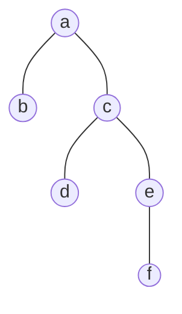
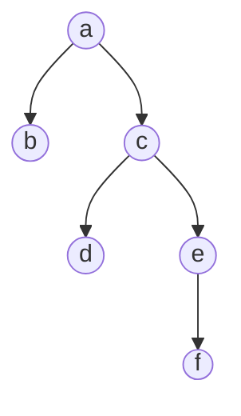
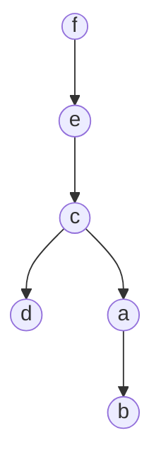
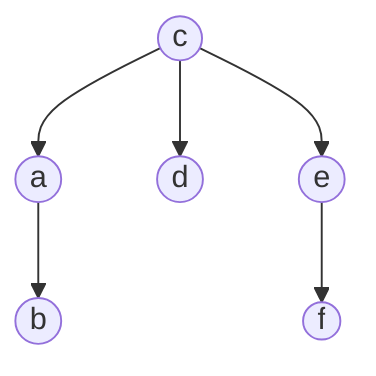
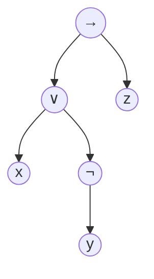
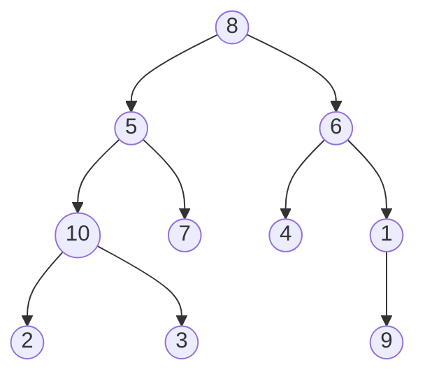
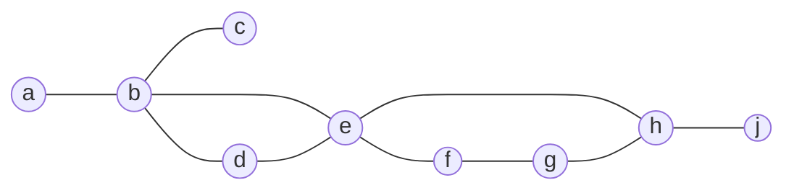
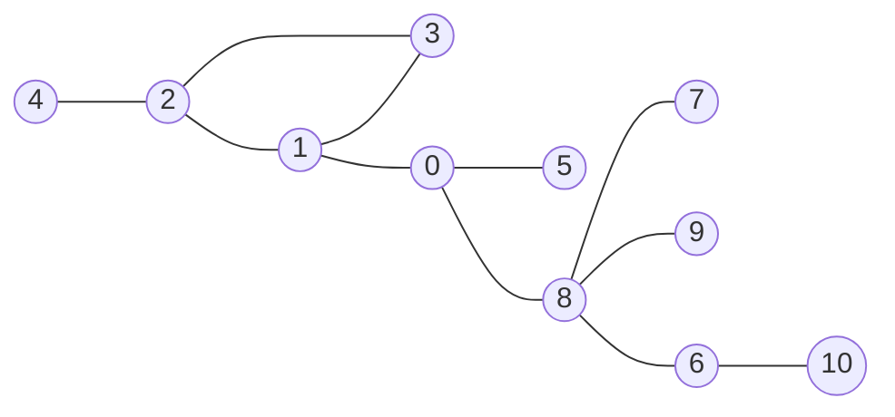

# Generalidades de los árboles · AyG C16

**Viernes 30 de octubre de 2026, de 7:00 a 9:00 el grupo B y de 9:00 a 11:00 el
grupo A, con el mismo contenido en las dos sesiones.**

Hasta aquí el árbol fue siempre el resultado de otra cosa. La búsqueda en
amplitud deja uno al calcular distancias, la búsqueda en profundidad deja el
que clasifica las aristas, y al contraer los componentes sin puentes de un
grafo conexo lo que queda es otro árbol. Ahora el árbol es el objeto. Un
ejemplo de seis vértices y cinco aristas alcanza para las cuatro propiedades
que se demuestran, y ese mismo árbol colgado de tres nodos distintos tiene
alturas $3$, $4$ y $2$ sin que una sola arista cambie de lugar. Después el
árbol se vuelve estructura de datos, con tres maneras de guardarlo, y
definición recursiva de dos renglones, de la que `contarNodos` y `altura` salen
en cinco líneas cada una. Los cuatro recorridos se leen sobre un árbol de diez
nodos que produce cuatro salidas distintas con los mismos nodos. Después viene
la excentricidad, sobre dos grafos: uno de nueve vértices con radio $2$ y
diámetro $4$, y otro de once donde el radio sube a $3$ y el diámetro a $6$. El
cierre es el diámetro de un árbol, que la vista recursiva calcula en una sola
pasada y que sobre el árbol de diez nodos vale $6$.

Al terminar la sesión se espera poder:

- Decidir si un grafo es un árbol con la caracterización más barata de
  comprobar y justificar las cuatro propiedades que se demostraron.
- Colgar un árbol de la raíz que convenga y decir qué cambia y qué se conserva
  al cambiarla.
- Escribir funciones recursivas sobre la especificación de dos renglones, con
  el caso base correcto.
- Producir a mano las cuatro salidas de los recorridos y escoger el que resuelve
  un problema dado.
- Calcular la excentricidad de cada vértice de un grafo pequeño y de ahí el
  radio, el diámetro y el centro.
- Calcular el diámetro de un árbol con la altura y el diámetro de cada
  subárbol, y decir qué cuesta.

## Diapositivas

[clase16-generalidades-arboles.pdf](./clase16-generalidades-arboles.pdf){ target=_blank rel=noopener },
70 páginas. Traen el árbol de seis vértices con sus tres raíces dibujadas una
al lado de la otra, los dos grafos de la excentricidad con sus valores en rojo
y la tabla de alturas con la que se arma el diámetro.

## Dónde habían aparecido ya los árboles

Las distancias que calcula la búsqueda en amplitud son las del árbol que ella
misma construye, y la búsqueda en profundidad usa su árbol para repartir las
aristas en de árbol, de regreso, de avance y cruzadas. Ese material está en la
[nota de representaciones y recorridos](../C6/Representaciones%20y%20recorridos.md#busqueda-en-profundidad).
El tercer caso resume un grafo conexo entero: cada componente sin puentes se
vuelve un nodo, las aristas que quedan son los puentes y el resultado es un
árbol, como se ve en la
[nota de problemas de cortes](../C11/Problemas%20de%20cortes.md#el-arbol-de-puentes).

Lo que falta es formalizarlos. De aquí en adelante el árbol tiene propiedades
propias que se demuestran y algoritmos que solo valen para él.

## Tres formas de mirar lo mismo

Como grafo, un árbol es un grafo no dirigido, conexo y acíclico. Esa vista
sirve para demostrar propiedades y para reutilizar lo que ya se sabe de grafos.
Como estructura de datos es un conjunto de nodos enlazados, cada uno con un
padre y varios hijos, y esa es la vista con la que se programa. Como definición
recursiva, un árbol es vacío o es un nodo con árboles colgando, y de ahí salen
las funciones que se llaman a sí mismas.

Las tres describen el mismo objeto. Ninguna necesita raíz para existir, pero
las dos últimas sí para escribirse: hay que decir cuál nodo no tiene padre.

## El árbol como grafo

### La definición

**Definición (CLRS, Apéndice B.5.1, p. 1173).** Un árbol es un grafo no
dirigido, conexo y acíclico.

Las tres palabras cuentan. No dirigido significa que las aristas no tienen
sentido. Conexo, que desde cualquier vértice se llega a cualquier otro.
Acíclico, que ningún camino sale de un vértice y vuelve a él sin repetir
aristas.

**Definición.** Un bosque es un grafo no dirigido y acíclico, sin pedirle que
sea conexo. Cada una de sus componentes conexas es un árbol.

### Un árbol de seis vértices



Tiene $|V| = 6$ y $|E| = 5$, es conexo y no tiene ciclos. No hay raíz dibujada
porque el grafo no la trae. De $b$ a $f$ hay un solo camino simple, $\langle b,
a, c, e, f \rangle$, y de $d$ a $b$ también uno solo, $\langle d, c, a, b
\rangle$. Esa no es una casualidad del dibujo.

### Para cada pareja hay un solo camino

**Teorema.** En un árbol, cada pareja de vértices está unida por exactamente un
camino simple.

Se procede por contradicción. Por conexidad hay al menos un camino entre $u$ y
$v$. Supóngase que hubiera dos distintos: entonces se separan en algún vértice
y se vuelven a juntar en otro, y el tramo de uno seguido del tramo del otro
recorrido al revés cierra un ciclo. Eso contradice que el grafo sea acíclico.

Por lo tanto, se puede concluir que el camino entre dos vértices de un árbol es
único. De esa unicidad vive casi todo lo que sigue: la distancia entre dos
vértices de un árbol no tiene alternativas que comparar, así que no hay nada
que optimizar al buscarla.

### Hay $n-1$ aristas y todas son puentes

**Teorema.** Un árbol de $n$ vértices tiene $n-1$ aristas, y quitar cualquiera
de ellas lo desconecta.

Que son puentes sale del camino único. Un puente es una arista cuya eliminación
parte el grafo; si la arista $\{u,v\}$ no lo fuera, al quitarla seguiría
habiendo un camino de $u$ a $v$, y ese camino más la arista cerrarían un ciclo.

Que son $n-1$ se demuestra por inducción sobre $n$. Con $n = 1$ no hay aristas
y la cuenta da $0$. Con $n > 1$, todo árbol tiene al menos un vértice de grado
$1$; al quitarlo queda un árbol de $n-1$ vértices, que por hipótesis de
inducción tiene $n-2$ aristas, y se devuelve la que se había quitado con él.

Por lo tanto, se puede concluir que $|E| = n-1$. Eso da dos formas baratas de
reconocer un árbol sin recorrerlo entero: un grafo conexo con $n-1$ aristas es
un árbol, y uno acíclico con $n-1$ aristas también.

### Cualquier nodo puede ser la raíz

El grafo no trae raíz. Escogerla es decidir desde dónde se mira: se toma un
vértice, se cuelga de él, y las aristas quedan apuntando hacia afuera. El grafo
no cambió, cambió el dibujo.



Colgado de $a$ el árbol tiene altura $3$. Colgado de $f$, altura $4$, porque
queda en fila hasta $b$.



Y colgado de $c$, altura $2$.



Las cinco aristas son las mismas en los tres dibujos. Lo que cambia es quién es
padre de quién, la profundidad de cada nodo y la altura del árbol. Lo que se
conserva son las aristas, las distancias entre vértices y cuáles son las hojas,
con la excepción del vértice que se haya escogido como raíz. Como la elección es
libre, varios algoritmos la aprovechan y toman la que les convenga: el vértice
$0$, una hoja, o el centro del árbol.

### Las hojas son los vértices de grado $1$

En el árbol sin raíz, una hoja es un vértice con una sola arista. En el de seis
vértices son $b$, $d$ y $f$. Con raíz la definición cambia a nodo sin hijos, y
ahí aparece una excepción: colgado de $f$, el vértice $f$ tiene grado $1$ y es
la raíz, no una hoja.

**Teorema.** Todo árbol con más de un vértice tiene al menos dos hojas.

Se procede por contradicción. Si todos los vértices tuvieran grado $\geq 2$, la
suma de los grados sería $\geq 2n$. Pero la suma de los grados de cualquier
grafo es $2|E|$, que en un árbol vale $2(n-1)$, y quedaría $2n \leq 2n-2$. El
mismo conteo con un solo vértice de grado $1$ deja $2n - 1 \leq 2n - 2$.

Por lo tanto, se puede concluir que hay al menos dos vértices de grado $1$.

## El árbol como estructura de datos

### Nodos enlazados

Un conjunto de nodos enlazados donde cada nodo tiene un único padre y varios
hijos; el único sin padre es la raíz. Aquí las aristas sí tienen sentido, del
padre al hijo. Es el árbol de antes con una raíz escogida y las aristas
orientadas.

### Cómo se llama cada cosa

Si la arista va de $u$ a $v$, entonces $u$ es el padre de $v$ y $v$ es hijo de
$u$. Dos hijos del mismo padre son hermanos. Los vértices que quedan en el
camino de la raíz a $v$, sin contar a $v$, son sus ancestros, y todos los que
cuelgan de $v$ son sus descendientes.

De la posición de un nodo se habla con cuatro términos. Una hoja es un nodo sin
hijos y un nodo interno es uno que sí los tiene. El subárbol de $v$ es $v$ con
todos sus descendientes, que por su cuenta vuelve a ser un árbol. La
profundidad de $v$ cuenta las aristas que hay de la raíz a $v$, de modo que la
raíz tiene profundidad $0$. La altura del árbol es la mayor profundidad.

El grado de un vértice, en el árbol sin raíz, es cuántas aristas toca. Con raíz
suele interesar más cuántos hijos tiene, que es el grado menos uno para todos
los nodos salvo la raíz.

### Cómo se guarda

Con listas de adyacencia, como cualquier grafo: `G[v]` trae los vecinos de `v`.
Sirve cuando el árbol llega sin raíz, que es como lo entregan casi todos los
problemas de juez, y para recorrerlo sin devolverse basta llevar en la llamada
de dónde se viene.

Con un arreglo de padres, donde `padre[v]` guarda el padre de `v` y la raíz
guarda $-1$. Ocupa $\Theta(n)$ y da el camino hacia la raíz de inmediato, pero
no da los hijos de un nodo sin recorrer todo el arreglo.

Con listas anidadas, donde el nodo trae adentro a sus hijos. Es la que sigue la
definición recursiva y la que se usa en el código de esta sesión.

## La especificación recursiva

### Un árbol es un nodo con árboles colgando

$$
\langle\text{arbol}\rangle ::= [\;] \;\mid\;
[\,n\;\; \langle\text{arbol}\rangle\;\; \langle\text{arbol}\rangle\,]
$$

Un árbol binario es la lista vacía, o una lista con el valor del nodo y sus dos
subárboles. La regla se nombra a sí misma, y por eso dos renglones describen
árboles de cualquier tamaño.

```python linenums="9"
a = []
b = [5, [], []]
c = [6, [3, [], []], []]
```

El primero es el árbol vacío. El segundo tiene un nodo con valor $5$ y dos
subárboles vacíos. El tercero tiene raíz $6$, un hijo izquierdo con valor $3$ y
ningún hijo derecho, que es lo que dice la lista vacía de la tercera posición.
Una pregunta para hacer la cuenta: ¿cuántos corchetes tiene un árbol de $n$
nodos escrito así?

### La misma forma en otra parte

$$
\varphi ::= \top \mid \bot \mid p \mid \lnot\varphi \mid
\varphi_1 \lor \varphi_2 \mid \varphi_1 \land \varphi_2 \mid
\varphi_1 \to \varphi_2
$$

Es la misma clase de definición, con un caso base y unos casos que se arman con
fórmulas más chicas. Por eso toda fórmula de la lógica se dibuja como un árbol.
El de $(x \lor \lnot y) \to z$ queda así:



Las hojas son las variables y los nodos internos son los conectivos. Evaluar la
fórmula con unos valores dados es recorrer el árbol de abajo hacia arriba.

### Contar los nodos

```python linenums="22"
def contarNodos(A):
  if len(A) == 0: ans = 0
  else:
    ans = 1 + contarNodos(A[1]) + contarNodos(A[2])
  return ans
```

La función sigue la gramática renglón por renglón. El caso base es la lista
vacía, que no tiene nodos. El otro caso cuenta la raíz y pregunta por cada
subárbol:

$$
\text{contarNodos}(T) = 1 + \text{contarNodos}(T_{izq}) + \text{contarNodos}(T_{der})
$$

Cada uno de esos dos vuelve a abrirse hasta llegar a listas vacías. Para el
árbol de diez nodos de la sesión da $10$. Cada nodo se visita una vez y hace
trabajo constante, así que el costo es $\Theta(n)$, y la pila de llamadas llega
a la altura del árbol.

### La altura, con la misma forma

```python linenums="28"
def altura(A):
  if len(A) == 0: ans = -1
  else:
    ans = 1 + max(altura(A[1]), altura(A[2]))
  return ans
```

El caso base vale $-1$ porque la altura se cuenta en aristas. Un árbol de un
solo nodo tiene altura $0$, y para que $1 + \max(-1, -1)$ dé ese $0$, el árbol
vacío tiene que valer $-1$.

Si cada nodo tiene un solo hijo, la altura es $n-1$ y la pila de llamadas
también. Con $n$ grande Python corta la recursión antes de terminar, y ahí toca
pasar a una pila explícita.

## Los recorridos

### Un árbol para recorrer



Diez nodos. El hijo izquierdo de $1$ es $9$ y $1$ no tiene hijo derecho, de
modo que el $9$ cuelga a la izquierda aunque el dibujo lo deje debajo. Si se
visitan los nodos y se escriben sus valores, el orden en que salen depende de
cuándo se escriba la raíz: antes de bajar, después de bajar, o entre los dos
hijos.

### Los tres de profundidad

```python linenums="19"
def preorden(A, ans):
  if len(A) > 0:
    ans.append(A[0])
    preorden(A[1], ans)
    preorden(A[2], ans)
  return ans

def posorden(A, ans):
  if len(A) > 0:
    posorden(A[1], ans)
    posorden(A[2], ans)
    ans.append(A[0])
  return ans

def inorden(A, ans):
  if len(A) > 0:
    inorden(A[1], ans)
    ans.append(A[0])
    inorden(A[2], ans)
  return ans
```

Preorden escribe la raíz, el subárbol izquierdo y el derecho. Posorden deja la
raíz para el final. Inorden la pone entre los dos hijos. Las tres funciones
visitan los mismos nodos y bajan por los mismos lados; lo único que se mueve es
el renglón que hace `ans.append(A[0])`.

### El de amplitud

```python linenums="40"
def niveles(A):
  ans, queue = [], deque()
  if len(A) > 0: queue.append(A)
  while len(queue) > 0:
    B = queue.popleft()
    ans.append(B[0])
    if len(B[1]) > 0: queue.append(B[1])
    if len(B[2]) > 0: queue.append(B[2])
  return ans
```

Aquí no hay recursión. Una cola guarda los subárboles pendientes: sale el
primero que entró, se escribe su raíz y entran sus dos hijos no vacíos. Es la
búsqueda en amplitud con el árbol como grafo, y lo que la distingue de las
otras tres es cuándo baja. Las de profundidad terminan una rama antes de
empezar la otra; esta termina un nivel antes de bajar al siguiente.

### Las cuatro salidas

| Recorrido | Salida |
|---|---|
| Preorden | $8\;5\;10\;2\;3\;7\;6\;4\;1\;9$ |
| Posorden | $2\;3\;10\;7\;5\;4\;9\;1\;6\;8$ |
| Inorden | $2\;10\;3\;5\;7\;8\;4\;6\;9\;1$ |
| Por niveles | $8\;5\;6\;10\;7\;4\;1\;2\;3\;9$ |

En preorden la raíz sale primero y en posorden sale última. En inorden queda en
la mitad, con los cinco nodos del subárbol izquierdo antes que ella. El de
niveles saca el $8$, después sus dos hijos, después los cuatro nietos y de
últimas el $9$, que está en el nivel más profundo.

### Para qué sirve cada uno

Preorden sirve para copiar o escribir el árbol, porque la raíz se necesita
antes que los hijos. Es también el orden en que la búsqueda en profundidad
descubre los nodos.

Posorden sirve para lo que depende de los hijos. El tamaño del subárbol, la
altura y el valor de una fórmula se calculan así, porque cuando le llega el
turno a la raíz los dos subárboles ya están resueltos. `contarNodos` y `altura`
son recorridos en posorden.

Inorden deja los valores ordenados en un árbol binario de búsqueda. Fuera de
ese caso no tiene una lectura especial, y en árboles de más de dos hijos ni
siquiera está bien definido.

El de niveles responde qué hay a distancia $1$, $2$ o $3$ de la raíz, que es
justo lo que contesta la búsqueda en amplitud sobre un grafo sin pesos.

## La excentricidad

### Qué tan lejos queda lo más lejano

**Definición.** La excentricidad de un vértice $v$ es la mayor de sus
distancias:

$$
\varepsilon(v) = \max_{u \in V} \delta(v, u).
$$

La distancia es la cantidad de aristas del camino más corto que une los dos
vértices, y como aquí las aristas no pesan, se mide contando pasos. Un vértice
con excentricidad $2$ alcanza a todos los demás en dos pasos o menos. Uno con
excentricidad $4$ tiene al menos un vértice a cuatro pasos.

### Las excentricidades de un grafo



Nueve vértices y diez aristas, así que no es un árbol: un árbol de nueve
vértices tendría ocho aristas, y las dos que sobran cierran dos ciclos, el de
$b$, $d$, $e$ y el de $e$, $f$, $g$, $h$. Los nueve valores son estos:

| $v$ | $a$ | $b$ | $c$ | $d$ | $e$ | $f$ | $g$ | $h$ | $j$ |
|---|---|---|---|---|---|---|---|---|---|
| $\varepsilon(v)$ | $4$ | $3$ | $4$ | $3$ | $2$ | $3$ | $4$ | $3$ | $4$ |

La menor es la de $e$, con $2$. La mayor la tienen $a$, $c$, $g$ y $j$, con
$4$. Tres de esos cuatro son vértices de grado $1$, y por eso quedan lejos de
todo; $g$ tiene grado $2$ y aun así queda a cuatro pasos de $a$ y de $c$, lo
que muestra que el grado no decide la excentricidad.

### Radio, diámetro y centro

**Definición.** El radio es la menor excentricidad, $r = \min_{v}
\varepsilon(v)$. El diámetro es la mayor, $d = \max_{v} \varepsilon(v)$. El
centro es el conjunto de vértices cuya excentricidad es el radio.

En el grafo del ejemplo, $r = 2$, $d = 4$ y el centro es $\{e\}$.

**Teorema.** En cualquier grafo conexo, $r \leq d \leq 2r$.

La primera desigualdad es inmediata, porque el mínimo de un conjunto no supera
su máximo. La segunda sale de pasar por un vértice $c$ del centro: dos vértices
cualesquiera están a lo sumo a $r$ de $c$, así que el camino que los une
pasando por $c$ mide a lo sumo $2r$, y la distancia entre ellos no puede ser
mayor que ese camino. El ejemplo cae en el caso extremo de la derecha, con
$2 \leq 4 \leq 4$: el diámetro es exactamente el doble del radio.

### Cómo se calculan

```python linenums="22"
def amplitud(s):
  dist = [-1 for _ in range(len(G))]
  dist[s] = 0
  queue = deque()
  queue.append(s)
  while len(queue) > 0:
    v = queue.popleft()
    for w in G[v]:
      if dist[w] == -1:
        dist[w] = dist[v] + 1
        queue.append(w)
  return dist

def excentricidad(v):
  dist = amplitud(v)
  ans = 0
  for w in range(len(G)):
    if dist[w] > ans: ans = dist[w]
  return ans
```

El grafo está en `G` con los índices $0$ a $8$ para los vértices de $a$ a $j$.
La amplitud desde $v$ da todas las distancias desde $v$ en $O(|V| + |E|)$, y la
mayor de ellas es $\varepsilon(v)$. Repetirlo desde cada vértice cuesta $O(|V|
\cdot (|V| + |E|))$, que para los nueve vértices del ejemplo es nada y para un
grafo de cien mil ya no.

### Otro grafo, once vértices



Once vértices numerados de $0$ a $10$ y once aristas, con el triángulo $1$,
$2$, $3$ como único ciclo. Antes de mirar los valores vale la pena calcular
seis distancias a mano: $\delta(0,7)$, $\delta(1,10)$, $\delta(6,10)$,
$\delta(4,7)$, $\delta(8,3)$ y $\delta(9,7)$. Dan $2$, $4$, $1$, $5$, $3$ y
$2$.

Las once excentricidades quedan así:

| $v$ | $0$ | $1$ | $2$ | $3$ | $4$ | $5$ | $6$ | $7$ | $8$ | $9$ | $10$ |
|---|---|---|---|---|---|---|---|---|---|---|---|
| $\varepsilon(v)$ | $3$ | $4$ | $5$ | $5$ | $6$ | $4$ | $5$ | $5$ | $4$ | $5$ | $6$ |

El radio es $3$, el diámetro $6$ y el centro $\{0\}$. Una excentricidad baja
dice que el vértice es central; una alta, que es periférico. El $4$ y el $10$,
los dos únicos con $6$, son los extremos del camino más largo, que mide seis
aristas y pasa por el $0$.

### Lo que cuesta calcularlos

Con todas las distancias a la mano el trabajo es recorrer la matriz: si ya se
tiene $\delta(u,v)$ para toda pareja, el radio y el diámetro salen en
$O(|V|^2)$.

Cuando no se tienen hay dos caminos. Floyd-Warshall las calcula todas en
$\Theta(|V|^3)$. Una amplitud desde cada vértice cuesta
$O(|V| \cdot (|V| + |E|))$, que es mejor cuando el grafo es disperso.

En un árbol se puede mejor. Un árbol tiene $n-1$ aristas y un solo camino entre
cada pareja, y con eso estas medidas no necesitan todas las distancias.

## El diámetro de un árbol

### Lo que tiene de particular un árbol

Cuatro hechos, todos ya vistos. Hay un único camino entre cualquier par de
nodos. Cualquier nodo puede tomarse como la raíz. Una hoja es cualquier nodo
que solo tiene un adyacente. Y el diámetro es la longitud de un camino que
conecta dos hojas.

El último sale de los anteriores. Si un extremo del camino más largo no fuera
hoja, tendría otro vecino por fuera del camino, y agregarlo alargaría el
camino. Entonces los dos extremos son hojas.

Queda una pregunta sobre el árbol de diez nodos de los recorridos: ¿cuál es su
camino más largo y cuánto mide?

### El camino más largo, con la vista recursiva

Es $\langle 2, 10, 5, 8, 6, 1, 9 \rangle$ y mide seis aristas. Pasa por la
raíz, y de ahí sale el algoritmo.

Con la raíz escogida, el camino más largo del árbol o pasa por la raíz, o no la
toca y entonces está entero dentro de uno de los dos subárboles. No hay más
opciones. Si pasa por la raíz, mide la altura del subárbol izquierdo más la del
derecho, más las dos aristas que los cuelgan de ella. Si no pasa, es el
diámetro de uno de los dos subárboles.

Eso es dividir, conquistar y combinar. Cada subárbol devuelve dos cosas, su
altura y su diámetro, y el nodo las combina con un máximo de tres candidatos.

### El código

```python linenums="13"
def diameter(v):
  global heights
  ans, h1, h2, diamLeft, diamRight = None, 0, 0, 0, 0
  if len(G[v]) == 0:
    heights[v] = 0
    ans = 0
  else:
    left = G[v][0]
    diamLeft = diameter(left)
    heights[v] = heights[left] + 1
    h1 = heights[left] + 1

    if len(G[v])  > 1:
      right = G[v][1]
      diamRight = diameter(right)
      heights[v] = max(heights[v], heights[right] + 1)
      h2 = heights[right] + 1
    ans = max(h1 + h2, diamLeft, diamRight)
  return ans
```

El árbol llega aquí como listas de hijos y con la raíz conocida: `G[v]` trae
los hijos de `v` y nada más, sin la arista de vuelta al padre. La función deja
en `heights` la altura de cada nodo y devuelve el diámetro. La línea 30 es la
que escoge entre el camino que pasa por el nodo y los diámetros de los dos
lados.

### El ejemplo, nodo por nodo

| Nodo | $2$ | $3$ | $7$ | $4$ | $9$ | $10$ | $1$ | $5$ | $6$ |
|---|---|---|---|---|---|---|---|---|---|
| Altura | $0$ | $0$ | $0$ | $0$ | $0$ | $1$ | $1$ | $2$ | $2$ |

Las cinco hojas valen $0$ y cada nodo interno toma el mayor de sus hijos más
uno. En la raíz $8$ la altura es $3$, y el candidato que pasa por ella mide
$(2+1) + (2+1) = 6$, que les gana a los diámetros de los dos lados. El diámetro
es $6$, el del camino de $2$ a $9$.

### Lo que cuesta

Cada nodo se resuelve con lo que devolvieron sus hijos y trabajo constante, así
que el tiempo es $\Theta(n)$ y la pila de llamadas llega a la altura del árbol.

Lo que pide a cambio es la raíz y las aristas en un solo sentido. Si el árbol
llega sin raíz, se escoge una cualquiera, que para esto da lo mismo.

## Errores comunes

**Confundir el grado con la cantidad de hijos.** En el árbol con raíz, un nodo
interno de grado $3$ tiene dos hijos y un padre. La raíz es el único nodo donde
el grado y la cantidad de hijos coinciden.

**Recorrer el árbol como grafo sin recordar de dónde se viene.** Con listas de
adyacencia, el vecino por el que se llegó vuelve a aparecer y el recorrido se
devuelve por donde entró. Se pasa el padre en la llamada y se salta.

**Creer que la altura no cambia con la raíz.** El mismo árbol colgado de dos
nodos distintos da alturas distintas, como pasa con $a$ y con $c$ en el de seis
vértices. Lo que no cambia son las aristas ni las distancias entre vértices.

**Pedir inorden en un árbol que no es binario.** Con tres hijos no hay un entre
los dos hijos que tenga sentido. Preorden y posorden se extienden sin cambios.

**Dejar la recursión donde no cabe.** Un árbol en fila de cien mil nodos
desborda la pila de Python. La versión con pila explícita es la que se envía al
juez.

## El código de la clase

[arboles.py](./codigo/arboles.py) trae la especificación recursiva con sus tres
ejemplos, el árbol de diez nodos, `contarNodos` y `altura`.
[recorridos.py](./codigo/recorridos.py) tiene los tres recorridos de
profundidad y el de niveles sobre el mismo árbol.
[excentricidad.py](./codigo/excentricidad.py) tiene la amplitud, la
excentricidad de un vértice y `radioDiametroCentro`, que devuelve los nueve
valores junto con el radio, el diámetro y el centro.
[20252-agra-diameterDandCBT.py](./codigo/20252-agra-diameterDandCBT.py) calcula
el diámetro de un árbol binario que llega como listas de hijos con la raíz
conocida, y deja de paso la altura de cada nodo en `heights`.

## Ejercicios

1. **Reconocer árboles.** De cada grafo diga si es árbol y por qué, usando la
   caracterización más barata de comprobar en cada caso: conexo con $n = 10$ y
   $|E| = 9$; acíclico con $n = 10$ y $|E| = 8$; conexo con $n = 10$ y
   $|E| = 10$; acíclico con $n = 10$ y $|E| = 9$. En el tercero, ¿cuántos
   ciclos simples hay como mínimo?
2. **Leer un recorrido.** De un árbol binario se sabe que su preorden es
   $7\;3\;1\;5\;4\;9\;8\;11$ y su inorden es $1\;3\;4\;5\;7\;8\;9\;11$. Dibuje
   el árbol y escriba su posorden. El primero del preorden es la raíz, y en el
   inorden lo que queda a su izquierda es el subárbol izquierdo y lo que queda a
   la derecha, el derecho; después se repite en cada pedazo. ¿Alcanzan el
   posorden y el inorden para reconstruir el árbol? ¿Y el preorden con el
   posorden?
3. **Contar hojas.** Escriba `contarHojas(A)` sobre la definición recursiva, con
   un solo `return` y sin librerías, donde una hoja es un nodo cuyos dos
   subárboles son vacíos. Escriba después `sumaProfundidades(A)`, que devuelve
   la suma de las profundidades de todos los nodos. ¿Qué parámetro hay que
   agregarle?
4. **Excentricidades a mano.** Sobre el árbol de seis vértices de esta sesión,
   calcule la excentricidad de los seis y diga cuáles son el radio, el diámetro
   y el centro. Compruebe que $r \leq d \leq 2r$ y diga cuántos vértices tiene
   el centro. ¿Puede un árbol tener tres vértices en el centro?
5. **UVa 10459, The Tree Root.** Dado un árbol, hay que decir cuáles vértices
   dan la menor altura al colgarlo de ellos y cuáles la mayor. Los primeros son
   el centro y los segundos son las hojas más lejanas. Enunciado en
   <https://onlinejudge.org/external/104/10459.pdf> y envío en
   <https://onlinejudge.org/index.php?option=com_onlinejudge&Itemid=25&page=submit_problem&problemid=1400>.
   Colgar el árbol de $v$ y mirar su altura es lo mismo que calcular
   $\varepsilon(v)$. Con $n$ hasta unos pocos miles, una amplitud desde cada
   vértice alcanza; con más, hay que esperar al algoritmo de dos recorridos.

## Lo que sigue

Hay otro camino al mismo número, y no pide escoger raíz: desde un vértice
cualquiera se busca el más lejano, y desde ese se vuelve a buscar. La distancia
entre los dos es el diámetro. De ahí salen el radio, que vale
$(\mathit{diam} + 1)/2$, y el centro, que se obtiene quitando las hojas una y
otra vez hasta que queden uno o dos vértices.

Para investigar:

- ¿Por qué el vértice más lejano a uno cualquiera es siempre un extremo de un
  camino más largo del árbol?
- Si se quitan todas las hojas de un árbol y se repite, ¿qué queda al final y
  cuántas vueltas toma?

## Referencias

- Cormen, Leiserson, Rivest, Stein. *Introduction to Algorithms*, 3.ª ed. MIT
  Press, 2009. Apéndice B.5, páginas 1173 a 1177, y Sección 10.4,
  representación de árboles con raíz.
- Halim, Halim, Effendy. *Competitive Programming 4*. Lulu, 2020. Capítulo 4:
  propiedades de los árboles, diámetro y centro.
- van Steen, M. *Graph Theory and Complex Networks*. Maarten van Steen, 2010.
  Capítulo 5: árboles, excentricidad y centro.
- UVa Online Judge, problema 10459. <https://onlinejudge.org>
