# Clase 6. Procedimientos recursivos y letrec

Martes 13 de octubre de 2026.

El lenguaje de la sesión anterior ya tiene procedimientos, y con ellos aparece
un límite que no se ve hasta que se intenta: un procedimiento declarado con
`let` no puede llamarse a sí mismo. El factorial, que es el primer ejemplo que
uno escribe, no se puede escribir. Esta sesión arregla eso con una forma
nueva, `letrec`, y el arreglo cabe en cuatro piezas: una producción de la
gramática, una variante del ambiente, un caso del observador y una línea del
evaluador.

Las diapositivas y los intérpretes están en el Campus Virtual. Aquí quedan las
notas y los apuntes del tablero.

Referencia: Friedman y Wand, *Essentials of Programming Languages*, 3.ª
edición, §3.4.

## El factorial que no se deja escribir

La escritura es la que uno espera, y el programa no corre:

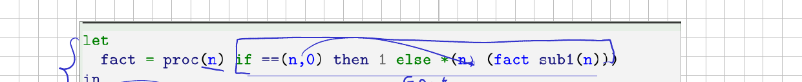

```
let fact = proc(n) if ==(n,0) then 1 else *(n, (fact sub1(n)))
in (fact 6)
```

El intérprete responde `No se encuentra la variable fact`. La cadena de
ambientes dice por qué:

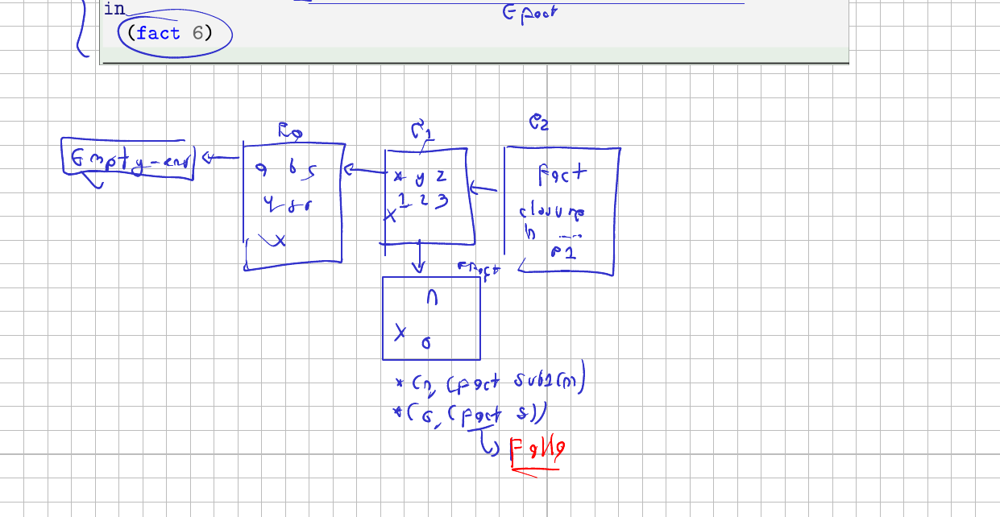

La clausura guarda el ambiente que existía **cuando se creó**, y en ese
momento la ligadura de `fact` todavía no estaba hecha: la parte derecha del
`let` se evalúa antes de extender. Cuando la llamada entra al cuerpo y busca
`fact`, recorre el eslabón del parámetro, salta al ambiente que la clausura
capturó y ahí no hay ningún `fact`.

El estorbo es de construcción, no de notación. Para armar la clausura hace
falta el ambiente, y para armar el ambiente hace falta la clausura. Cada una
espera a la otra.

## Guardar declaraciones en vez de clausuras

La salida es no guardar la clausura. El ambiente guarda con qué se fabrica una
clausura, y la fabricación se aplaza. Eso es una variante nueva del TAD:

```scheme
(ambiente-extendido-recursivo
 (nombre-procedimientos (list-of symbol?))
 (argumentos-proc (list-of (list-of symbol?)))
 (cuerpos-proc (list-of expresion?))
 (old-env ambiente?))
```

Este es el marco recursivo. Tres listas parejas y el ambiente que extiende. En la posición `k` de las tres
está todo lo que define al procedimiento `k`: su nombre, sus parámetros y su
cuerpo sin evaluar. El ambiente extendido de siempre guarda valores; este
guarda símbolos, listas de símbolos y expresiones.

## La clausura nace al buscar el nombre

Con las declaraciones adentro, el trabajo se mueve al observador. `apply-env`
gana un caso: si el nombre buscado está entre los declarados, devuelve una
clausura armada en ese momento; si no, sigue por el ambiente que el marco
extiende, como cualquier otro eslabón.

```scheme
(ambiente-extendido-recursivo (procnames lidss cuerpos old-env)
  (letrec
      ((buscar-variable
        (lambda (procnames lidss cuerpos old-env)
          (cond
            [(null? procnames) (apply-env old-env var)]
            [(equal? (car procnames) var)
             (closure (car lidss) (car cuerpos) env)]
            [else
             (buscar-variable (cdr procnames) (cdr lidss) (cdr cuerpos) old-env)]))))
    (buscar-variable procnames lidss cuerpos old-env)))
```

La línea que decide todo es `(closure (car lidss) (car cuerpos) env)`. El
ambiente que se le da a la clausura es `env`, el marco recursivo completo, y
no `old-env`. Por eso el cuerpo, al ejecutarse, vuelve a encontrar el nombre
del procedimiento: la clausura apunta al marco que la declara.

Cada consulta fabrica una clausura nueva. Un programa que declara un
procedimiento y nunca lo nombra no crea ninguna.

```
letrec doble(n) = *(n,2) in 7
```

vale 7 y no construye clausuras. En cambio basta con nombrar el procedimiento,
sin aplicarlo, para que aparezca una:

```
letrec doble(n) = *(n,2) in doble
```

y el intérprete imprime la clausura con su ambiente, donde se leen las tres
listas:

```
#(struct:closure (n) #(struct:prim-exp #(struct:mult-prim) (#(struct:var-exp n) #(struct:lit-exp 2)))
  #(struct:ambiente-extendido-recursivo (doble) ((n)) (#(struct:prim-exp ...)) ...))
```

## La regla de evaluación

El evaluador aporta una línea. Evaluar un `letrec` es evaluar su cuerpo sobre
el ambiente extendido recursivo que se arma con los nombres, los parámetros,
los cuerpos y el ambiente actual:

```scheme
(letrec-exp (procnames idss cuerpos cuerpo-letrec)
            (evaluar-expresion cuerpo-letrec
                               (ambiente-extendido-recursivo procnames idss cuerpos amb)))
```

## El factorial, ahora sí

El mismo programa con `letrec` sí corre, y da 720:

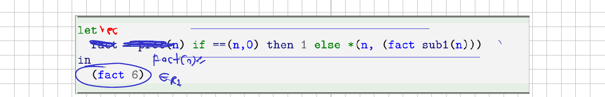

```
letrec fact(n) = if ==(n,0) then 1 else *(n, (fact sub1(n)))
in (fact 6)
```

La cadena cambia de forma. El marco recursivo queda fijo al fondo y de él
cuelga un eslabón por cada llamada, cada uno con su `n`:

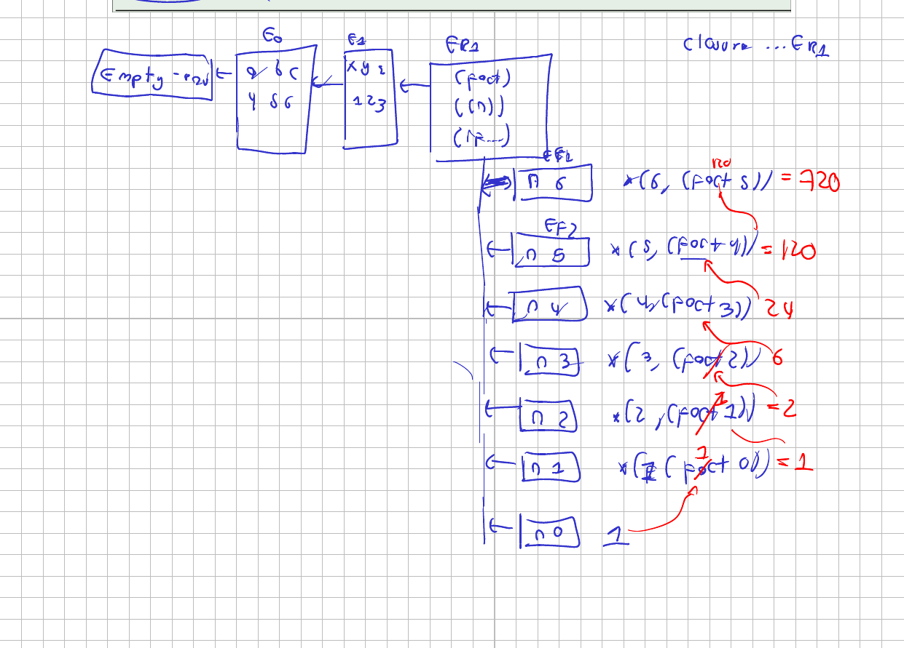

Las flechas de los siete eslabones apuntan al mismo sitio, y ahí está la
diferencia con la versión anterior. Ninguna llamada cuelga de la que la
produjo: todas extienden el marco recursivo, que es el ambiente que las
clausuras capturaron.

Los retornos se arman de abajo hacia arriba. `fact(0)` da 1, y de ahí salen
1, 2, 6, 24, 120 y 720.

## Por qué solo procedimientos

`letrec` declara procedimientos y nada más. Con una ligadura cualquiera la
construcción perdería sentido: `letrec x = +(x,1)` no tiene valor que
calcular ni punto donde parar, porque la parte derecha se mira a sí misma sin
una llamada de por medio que pueda terminar. Un procedimiento aplaza esa
mirada hasta la aplicación, y ahí sí hay un caso base que la corta.

## Un letrec dentro de un let

El segundo ejemplo de la sesión mezcla las dos formas: un `let` con tres
ligaduras por fuera y el `letrec` por dentro.

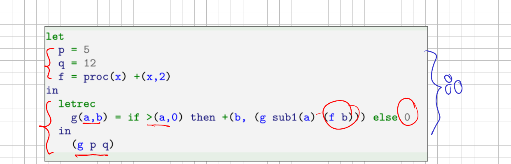

```
let p = 5
    q = 12
    f = proc(x) +(x,2)
in letrec g(a,b) = if >(a,0) then +(b, (g sub1(a) (f b))) else 0
   in (g p q)
```

Vale 80. Cada vuelta baja `a` en uno y pasa `b` por `f`, que le suma 2, así
que los segundos argumentos van 12, 14, 16, 18, 20 y 22, y las sumas se cierran
al regreso: 20, 38, 54, 68 y 80.

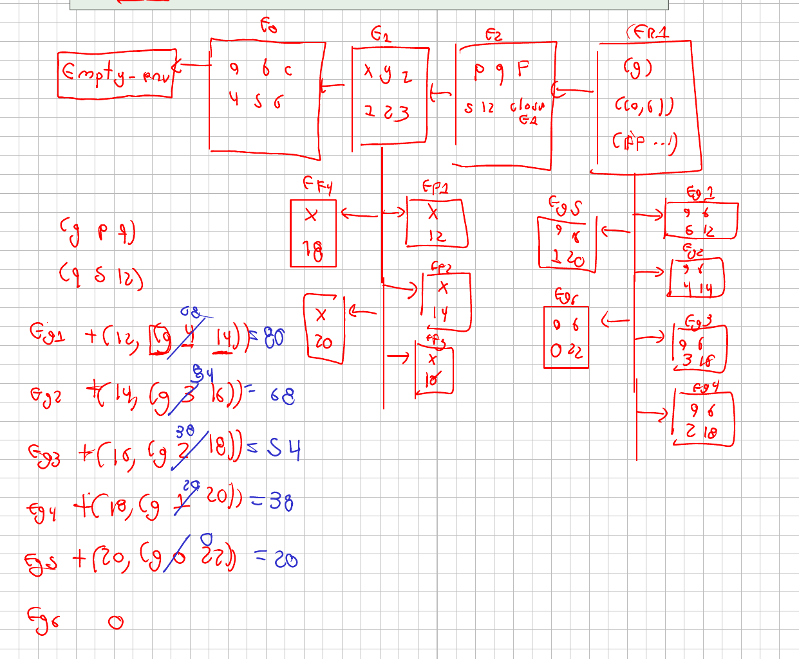

En la cadena se ven las dos familias de eslabones: los de `g`, que cuelgan del
marco recursivo, y los de `f`, que cuelgan del ambiente del `let` donde se
declaró. Dos procedimientos del mismo programa extienden ambientes distintos
porque capturaron ambientes distintos.

## Un ambiente se crea en tres momentos

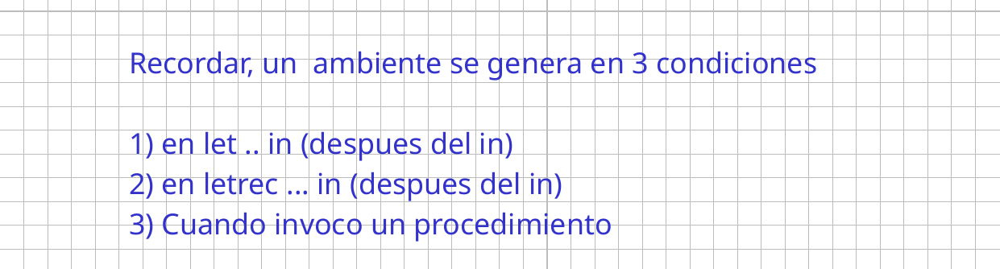

No hay más. Declarar `f = proc(x) ...` dentro de un `let` no crea ninguno: se
construye la clausura y se guarda, y el ambiente aparece después, al pasar el
`in`. Contar eslabones es contar estas tres cosas.

## Contar lo que hace un programa

Con esa regla se sabe de antemano cuántos ambientes construye un programa, y
lo mismo con las clausuras y las aplicaciones.

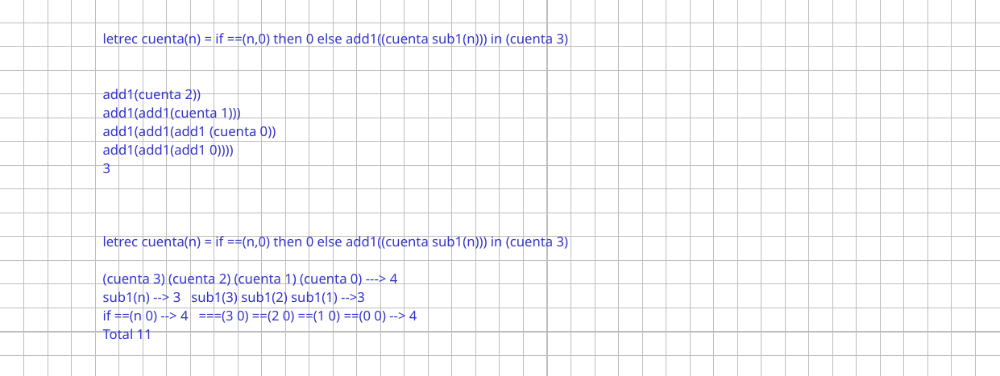

```
letrec cuenta(n) = if ==(n,0) then 0 else add1((cuenta sub1(n)))
in (cuenta 3)
```

Vale 3, y se ve al desdoblarlo: `add1(add1(add1(cuenta(0))))` con
`cuenta(0) = 0`. El conteo separa unas aplicaciones de otras. `cuenta` se
aplica cuatro veces, con 3, 2, 1 y 0; `sub1`, tres; `==`, cuatro. Once en
total.

El otro ejemplo suma en lugar de contar:

```
letrec suma(n) = if ==(n,0) then 0 else +(n, (suma sub1(n)))
in (suma 4)
```

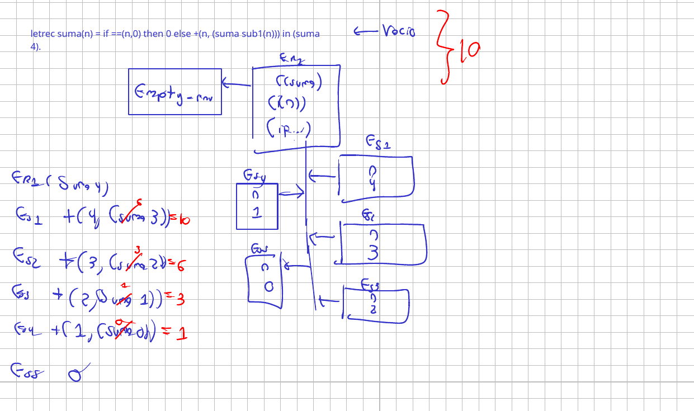

Vale 10, y la cadena tiene la misma forma que la del factorial: un marco
recursivo y cinco eslabones colgando de él.

## Recursión mutua

Dos procedimientos que se llaman cruzado solo funcionan si están declarados en
el mismo marco. Con dos `letrec` anidados el de afuera no ve al de adentro:

```
letrec par(n) = if ==(n,0) then 1 else (impar sub1(n))
in letrec impar(n) = if ==(n,0) then 0 else (par sub1(n))
   in (par 7)
```

se detiene con `No se encuentra la variable impar`, porque la clausura de
`par` captura su propio marco, donde solo está `par`. Declarar los dos juntos
lo arregla:

```
letrec par(n) = if ==(n,0) then 1 else (impar sub1(n))
       impar(n) = if ==(n,0) then 0 else (par sub1(n))
in (par 7)
```

Esto vale 0. Ahora `procnames` es `(par impar)`, `idss` es `((n) (n))` y
`cuerpos` trae los dos cuerpos, y las dos clausuras capturan ese mismo marco,
así que cada una encuentra a la otra.

## El ejercicio del parcial, reescrito

La última parte de la sesión tomó un ejercicio de cadena de ambientes de los
que se resuelven con procedimientos y lo pasó a `letrec`.

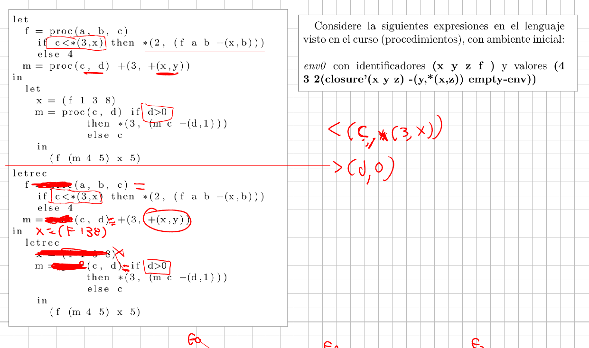

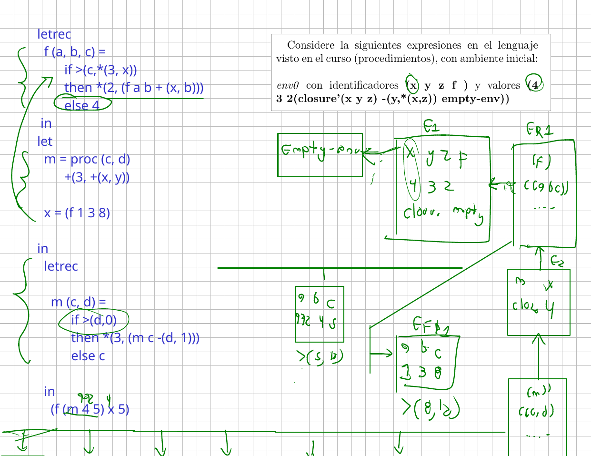

El método no cambia. Se dibuja el ambiente inicial y se agrega un eslabón por
cada `in` y por cada aplicación. Lo único propio del `letrec` es que los
eslabones de las llamadas cuelgan todos del marco donde el procedimiento está
declarado, y no uno del otro.

## Ejercicios de la segunda mitad

Los ejercicios interactivos de esta sesión están en
[Ejercicios · FLP C6](./Ejercicios.md){ target=_blank rel=noopener }: la
gramática del `letrec`, qué guarda el marco, el TAD armado con listas
etiquetadas, las trazas, la recursión mutua y el dibujo de la cadena.

## Los apuntes del tablero

{ type=application/pdf style="min-height:70vh;width:100%" }

## Lo que sigue

Con `letrec` se cierra el primer corte del lenguaje. Lo que viene cambia el
modelo de memoria: variables que se asignan, el almacén y el paso por
referencia.
