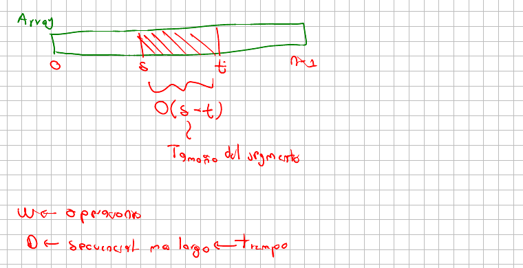
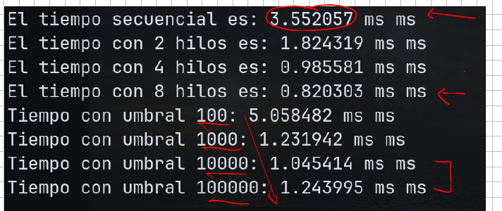

# Clase 11. Complejidad de la concurrencia

**Jueves 19 de noviembre de 2026, de 7:00 a 10:00 el grupo 50 y de 14:00 a
17:00 el grupo 51, con el mismo contenido en las dos sesiones.**

La sesión anterior midió un speedup de 2,80 con cuatro núcleos y dejó la
diferencia sin explicar. Hay dos formas de atacarla. Una se hace sobre el
código, contando operaciones y dependencias, y da el tope de la ganancia antes
de ejecutar nada. La otra se hace con el reloj en una máquina concreta, y trae
su propia dificultad: la JVM tarda en estabilizarse y las primeras mediciones
mienten.

## Analizar y medir

El análisis asintótico pregunta cómo escala el programa cuando crecen la entrada
o los recursos. La respuesta sale del algoritmo y no de la máquina. La medición
pregunta otra cosa: cuánto tarda este programa en esta máquina, con esta JVM y
esta entrada.

Las dos hacen falta. El análisis predice qué ocurre al doblar el tamaño del
problema o el número de núcleos; la medición dice si la implementación cumplió
la predicción. Cuando no coinciden, al modelo le falta algún costo que el conteo
de operaciones no ve, como repartir el trabajo, esperar a que todos terminen o
mover datos entre cachés.

## El segmento y las dos medidas

El ejemplo de arranque recorre un arreglo entre dos índices y acumula:

```scala
def sumSegment(a: Array[Int], p: Double, s: Int, t: Int): Double = {
  def aux(i: Int, acc: Double): Double =
    if (i >= t) acc
    else aux(i + 1, acc + power(a(i), p))
  aux(s, 0.0)
}
```

Hay una operación de costo constante por elemento, así que el costo es
proporcional al tamaño del segmento, $O(t - s)$. El dibujo del tablero fija los
cuatro índices que importan y deja escritas las dos medidas de la sesión:



El trabajo $W(e)$ cuenta todas las operaciones que toma evaluar $e$ como si no
hubiera paralelismo, de modo que coincide con el costo secuencial. La
profundidad $D(e)$ es la cadena más larga de operaciones que tienen que ocurrir
una después de la otra, suponiendo núcleos sin límite. El trabajo dice cuánto
hay que hacer. La profundidad dice qué tan corto puede llegar a ser el tiempo.

Las dos se componen con reglas distintas. En una llamada secuencial el trabajo
y la profundidad se suman sobre los argumentos y sobre la función que los
recibe. En `parallel` solo se suma el trabajo:

$$W(\mathtt{parallel}(e_1, e_2)) = W(e_1) + W(e_2) + c_1$$

$$D(\mathtt{parallel}(e_1, e_2)) = \max\big(D(e_1), D(e_2)\big) + c_2$$

La profundidad pasa de suma a máximo, y de ese único cambio sale toda la
ganancia del paralelismo.

## Ocho enteros en dos órdenes

Sumar los enteros de 1 a 8 encadenando las sumas, `((((((1+2)+3)+4)+5)+6)+7)+8`,
da siete pasos donde cada uno espera al anterior:

| Paso | Operación | Resultado | Depende de |
|---:|---|---:|---|
| 1 | 1 + 2 | 3 | |
| 2 | 3 + 3 | 6 | paso 1 |
| 3 | 6 + 4 | 10 | paso 2 |
| 4 | 10 + 5 | 15 | paso 3 |
| 5 | 15 + 6 | 21 | paso 4 |
| 6 | 21 + 7 | 28 | paso 5 |
| 7 | 28 + 8 | 36 | paso 6 |

El trabajo es 7 y la profundidad también. Con mil núcleos sigue tomando siete
unidades de tiempo, porque ningún paso puede empezar antes de que termine el que
lo precede.

El mismo cómputo, reordenado por niveles, cambia de forma:

| Nivel | Operaciones, todas a la vez | Resultados |
|---:|---|---|
| 0 | 1 + 2, 3 + 4, 5 + 6, 7 + 8 | 3, 7, 11, 15 |
| 1 | 3 + 7, 11 + 15 | 10, 26 |
| 2 | 10 + 26 | 36 |

El trabajo vuelve a ser 7, ahora como 4 + 2 + 1, y la profundidad baja a 3. Con
cuatro núcleos cada nivel toma una unidad y el total son tres, así que el
speedup sube a 7/3, unas 2,33 veces. La suma es la misma operación de antes; lo
que cambió fue el orden de las dependencias.

## El mismo cómputo cuando crece n

| n | Trabajo | Profundidad encadenada | Profundidad en árbol | Speedup máximo |
|---:|---:|---:|---:|---:|
| 4 | 3 | 3 | 2 | 1,50 |
| 8 | 7 | 7 | 3 | 2,33 |
| 16 | 15 | 15 | 4 | 3,75 |
| 32 | 31 | 31 | 5 | 6,20 |
| 1024 | 1023 | 1023 | 10 | 102,30 |
| $n$ | $n - 1$ | $n - 1$ | $\log_2 n$ | $n / \log_2 n$ |

El trabajo crece lineal con $n$ y la profundidad en árbol crece logarítmica, de
manera que el tope $W/D$ sube con el tamaño del problema. Los problemas grandes
reparten mejor que los pequeños.

## segmentRec en paralelo

La versión que se analizó en clase parte el segmento por la mitad y lanza las
dos mitades con `parallel`, salvo cuando el segmento ya es más corto que el
umbral:

```scala
def segmentRecPar(a: Array[Int], p: Double, s: Int, t: Int): Double =
  if (t - s < limite) sumSegment(a, p, s, t)
  else {
    val m = s + (t - s) / 2
    val (sum1, sum2) = parallel(
      segmentRecPar(a, p, s, m),
      segmentRecPar(a, p, m, t)
    )
    sum1 + sum2
  }
```

Las dos recurrencias se leen del código. El trabajo suma las dos mitades y el
costo de repartir, y se resuelve en $W(s, t) = O(t - s)$: el mismo costo lineal
del secuencial. La profundidad toma el máximo de las dos mitades, y con el
umbral constante se resuelve en $D(s, t) = O(\log(t - s))$. Mismo trabajo,
profundidad logarítmica.

## El tiempo con P núcleos

Con $P$ núcleos hay dos cotas que se cumplen siempre: $T_P \ge D(e)$, porque
nadie va más rápido que el camino crítico, y $T_P \ge W(e)/P$, porque el trabajo
hay que hacerlo y se reparte entre $P$ como mucho. La estimación que se usa
combina las dos:

$$T_P \approx D(e) + \frac{W(e)}{P}$$

Aplicada al segmento queda $T_P(n) \approx O(\log n) + O(n)/P$. Con $P = 1$
reaparece el tiempo lineal del secuencial. Con $P$ tan grande como se quiera y
$n$ fijo manda la profundidad, $O(\log n)$. Con cuatro núcleos y diez millones
de elementos el término del trabajo domina por mucho, y el tope del speedup
ronda 4.

El speedup es $S_P = T_1 / T_P$. Vale $P$ cuando el reparto es perfecto, queda
por debajo cuando hay sobrecosto y baja de 1 cuando repartir costó más de lo que
ahorró. Por encima de $P$ se ve de vez en cuando, y suele ser efecto de la
caché.

## La ley de Amdahl

Supóngase que una fracción $f$ del programa es secuencial por su naturaleza y el
resto, $1 - f$, se reparte sin pérdida:

$$S_P = \frac{1}{f + \dfrac{1 - f}{P}} \qquad\qquad S_\infty = \frac{1}{f}$$

En clase la fórmula se evaluó en el intérprete de Python, con la fracción
secuencial como segundo argumento:

```python
>>> f = lambda P,F: 1/(F+(1-F)/P)
>>> f(8,0.4)
2.1052631578947367
>>> f(16,0.4)
2.2857142857142856
>>> f(8,0.2)
3.333333333333333
```


Doblar de 8 a 16 núcleos con un 40 % secuencial mueve el speedup de 2,11 a 2,29,
menos de dos décimas por el doble de hardware. Bajar la fracción secuencial del
40 % al 20 % con los mismos 8 núcleos lo lleva a 3,33. La conclusión del tablero
es de diseño antes que de compra: lo que decide cuánto se puede ganar es la
parte que no se reparte.

La tabla completa muestra dónde se aplana cada fila:

| $f$ | P = 2 | P = 4 | P = 8 | P = 16 | P = 32 | $S_\infty$ |
|---:|---:|---:|---:|---:|---:|---:|
| 0,05 | 1,90 | 3,48 | 5,93 | 9,14 | 12,55 | 20,00 |
| 0,10 | 1,82 | 3,08 | 4,71 | 6,40 | 7,80 | 10,00 |
| 0,20 | 1,67 | 2,50 | 3,33 | 4,00 | 4,44 | 5,00 |
| 0,40 | 1,43 | 1,82 | 2,11 | 2,29 | 2,39 | 2,50 |

Con un 40 % secuencial el speedup nunca pasa de 2,50, por muchos núcleos que se
añadan.

## Una medición no es un número

Una prueba da una respuesta binaria: el programa cumple su contrato o no lo
cumple. Una medición da un valor distinto cada vez. La sesión abrió con diez
tiempos del mismo programa, en la misma máquina y sin nadie más usándola:

```text
40.1   9.4   8.1   9.7  10.1
 9.4   9.3  10.4  10.9   9.7
```

La primera medición cuadruplica a la mediana y las otras nueve se mueven entre
8,1 y 10,9. Reportar la primera como el tiempo del programa sería un error, y
promediar las diez tampoco sirve, porque esa primera arrastra la media.

El hardware pone su parte: la velocidad y el número de procesadores, el ancho
de banda de memoria, el comportamiento de las cachés. La JVM pone la suya, con
el recolector de basura y la compilación JIT, y encima de las dos está la
planificación de hilos que hace el sistema operativo. Lo que se mide es una
variable aleatoria y se reporta con estadística.

## El calentamiento de la JVM

Un programa recién lanzado pasa por cuatro etapas: ejecución interpretada,
compilación JIT de los métodos calientes, optimizaciones especulativas y estado
estable. Diez repeticiones de `measure` sobre la suma de un arreglo de $10^8$
enteros, sin calentar, lo dejan ver:

```text
59.766833 ms
54.464319 ms
25.126186 ms
26.241147 ms
25.830602 ms
26.647554 ms
26.470388 ms
24.866799 ms
26.190944 ms
26.411821 ms
```

La primera da 59,77 ms y la segunda 54,46; de la tercera en adelante los tiempos
se concentran entre 24,87 y 26,65 ms. El código medido es el mismo en las diez
repeticiones, así que el desfase viene de la JVM y no del programa. Envolver la
medición en un calentador lo corrige:

```scala
val t = withWarmer(new Warmer.Default) measure {
  sumarArray(arr)
}
```

ScalaMeter ejecuta el bloque, descarta cada medición y vigila la varianza entre
tiempos consecutivos; solo cuando esa varianza cae bajo un umbral interno
reporta la primera medición real. El primer valor que devuelve esta versión es
24,93 ms. Cae dentro del bloque estable, que queda entre 25,20 y 27,13 ms. El
promedio de las diez pasa de 32,20 ms a 25,81 ms, y los casi 6 ms de diferencia
son el peso de los dos atípicos iniciales.

Hay tres calentadores y cada uno sirve para una situación distinta:

| Calentador | Qué hace | Cuándo |
|---|---|---|
| `new Warmer.Default()` | Repite el bloque hasta que la varianza entre tiempos consecutivos baja de un umbral | Caso general |
| `Warmer.Zero` | No calienta: la primera repetición ya es la primera medición | Medir el arranque en frío |
| `new Warmer.JvmHeating()` | Número fijo de iteraciones, suficiente para que HotSpot compile | Suites grandes donde el adaptativo tarda demasiado |

`Warmer.Zero` es un `object` y se escribe sin `new`; los otros dos son clases y
se instancian.

## Cuatro hilos sobre el arreglo

La medición de la clase partió el arreglo en cuartos y sumó los cuatro con dos
`parallel` anidados, donde `reduceSeq` recorre un rango de corrido:

```scala
val fourthread = withWarmer(new Warmer.Default) measure {
  val ((r1, r2), (r3, r4)) =
    parallel(
      parallel(reduceSeq(a, 0, a.length / 4), reduceSeq(a, a.length / 4, a.length / 2)),
      parallel(
        reduceSeq(a, a.length / 2, 3 * a.length / 4),
        reduceSeq(a, 3 * a.length / 4, a.length)
      )
    )
  val sum = r1 + r2 + r3 + r4
}
println("El tiempo con 4 hilos es: " + fourthread + " ms")
```


Cada hoja recibe $n/4$ elementos y las cuatro avanzan a la vez. La suma
`r1 + r2 + r3 + r4` es el join, y es justamente la parte que no se reparte. La
corrida, con la versión secuencial y con dos, cuatro y ocho hilos:

```text
El tiempo secuencial es: 3.552057 ms ms
El tiempo con 2 hilos es: 1.824319 ms ms
El tiempo con 4 hilos es: 0.985581 ms ms
El tiempo con 8 hilos es: 0.820303 ms ms
```

La unidad aparece dos veces porque el valor que devuelve `measure` ya la trae y
el `println` agrega otra. Dividiendo el tiempo secuencial entre cada uno de los
demás salen los speedups:

| Hilos | Tiempo (ms) | Speedup |
|---:|---:|---:|
| 1 | 3,552057 | 1,00 |
| 2 | 1,824319 | 1,95 |
| 4 | 0,985581 | 3,60 |
| 8 | 0,820303 | 4,33 |

Dos hilos casi duplican. Cuatro se quedan en 3,60 y ocho llegan a 4,33: al pasar
de cuatro a ocho el tiempo baja un 17 %, con el doble de hilos. La curva se
aplana como las de Amdahl.

La tabla de referencia de la sesión, sobre cuatro núcleos y diez millones de
elementos, cuenta la misma historia con otros números: 42 ms en secuencial,
24 ms con dos hilos y 15 ms con cuatro, es decir speedups de 1,75 y 2,80. De los
42 ms y los 15 ms se despeja una fracción secuencial cercana al 14 %. Lo que se
pierde frente al 4 ideal sale de tres sitios: el sobrecosto de `parallel` y del
join, la suma final que viene después de cada reparto y la contención de memoria
y de cachés.

## El umbral y cuándo no conviene paralelizar

El mismo arreglo, cambiando el tamaño por debajo del cual el segmento se suma de
corrido:

```text
Tiempo con umbral 100: 5.058482 ms ms
Tiempo con umbral 1000: 1.231942 ms ms
Tiempo con umbral 10000: 1.045414 ms ms
Tiempo con umbral 100000: 1.243995 ms ms
```



Con umbral 100 la corrida tarda 5,058482 ms, más que los 3,552057 ms del
secuencial completo: el árbol se parte tanto que crear y juntar tareas se come
la ganancia. El mínimo está en 10000, con 1,045414 ms. Al subir a 100000 el
tiempo vuelve a crecer hasta 1,243995 ms, porque quedan pocas hojas para
repartir.

De ahí las señales para no paralelizar. Una entrada pequeña deja el sobrecosto
por encima de lo que se ahorra. Con una fracción secuencial alta, Amdahl cierra
la puerta antes de empezar, y cuando la operación cuesta casi nada no hay tiempo
que ganar. La regla práctica es medir primero el secuencial: si toma
microsegundos, repartirlo lo empeora.

## El código de la clase

Cada grupo corrió su propia versión del mismo programa y las dos quedan aquí.
[01_reduce_con_hilos.scala](./codigo/01_reduce_con_hilos.scala) suma diez
millones de enteros en secuencial, con dos, cuatro y ocho hilos, después con
cuatro `task`, y termina con los umbrales 100, 1000, 10000 y 100000, que son los
de la corrida de arriba.
[02_suma_segmento_con_umbrales.scala](./codigo/02_suma_segmento_con_umbrales.scala)
parte el segmento hasta el umbral con `sumaSegPar`, prueba siete valores entre
500 y 50000, y mide el secuencial varias veces para sacarle promedio y
desviación.

`parallel` y `task` salen del paquete `common` de la plantilla del curso;
`withWarmer` y `measure`, de ScalaMeter, que la plantilla ya declara en su
`build.gradle`. Los dos archivos van en `app/src/main/scala/taller/` y corren
con `./gradlew run`.

## Ejercicios de la segunda mitad

[Ejercicios · PFC C11](./Ejercicios.md){ target=_blank rel=noopener }: seis
actividades en el orden de la clase, desde las dos preguntas hasta el
calentamiento de la JVM. El trabajo y la profundidad salen de contar las
operaciones del recorrido, la tabla de Amdahl de evaluar la fórmula para cada
fracción y cada cantidad de núcleos, y las medias y las medianas de las listas
de tiempos que se midieron en la sesión.

## Los apuntes del tablero

{ type=application/pdf style="min-height:70vh;width:100%" }

## Lo que sigue

Paralelismo de tareas y de datos sobre estructuras completas: el ordenamiento
por mezcla en paralelo, `map` y `reduce` sobre arreglos y árboles, la
asociatividad como condición para que el reparto no cambie el resultado, y
`scan`. La pregunta para llevar: por qué `reduce` se puede paralelizar y
`foldLeft` no.
